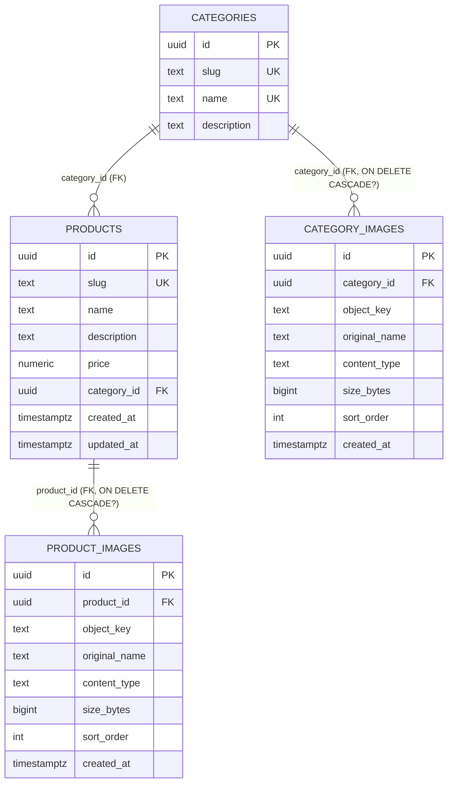
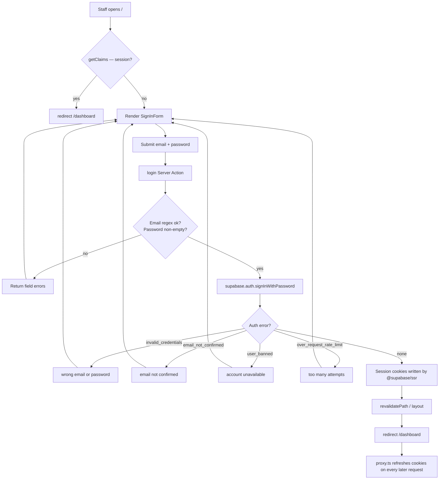
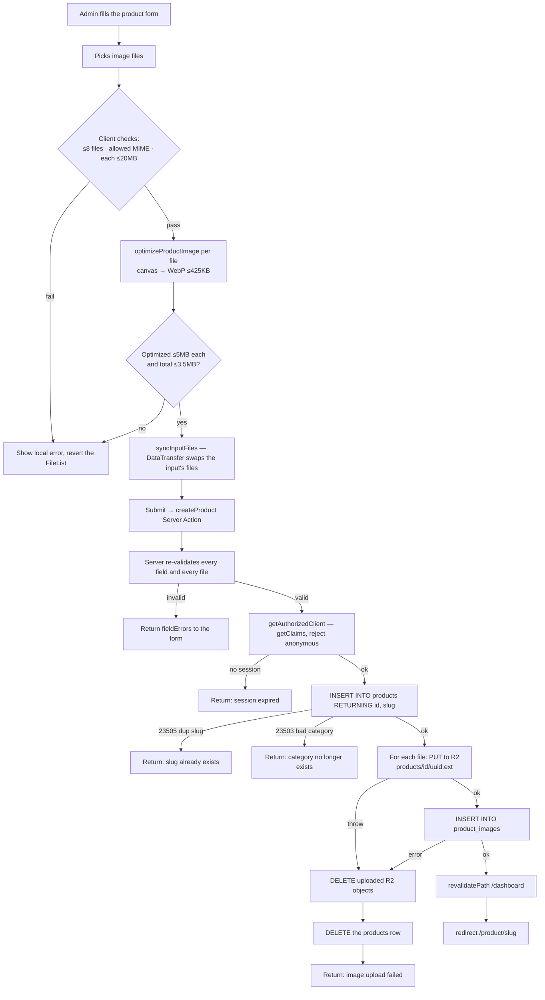
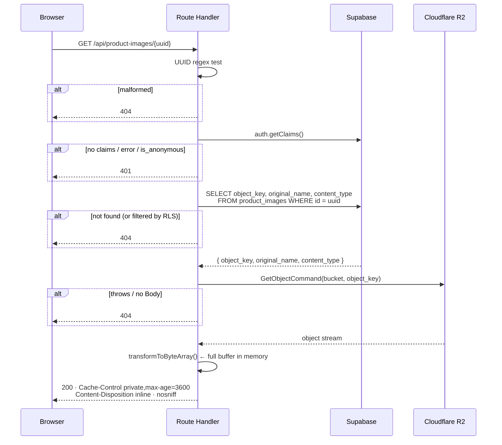
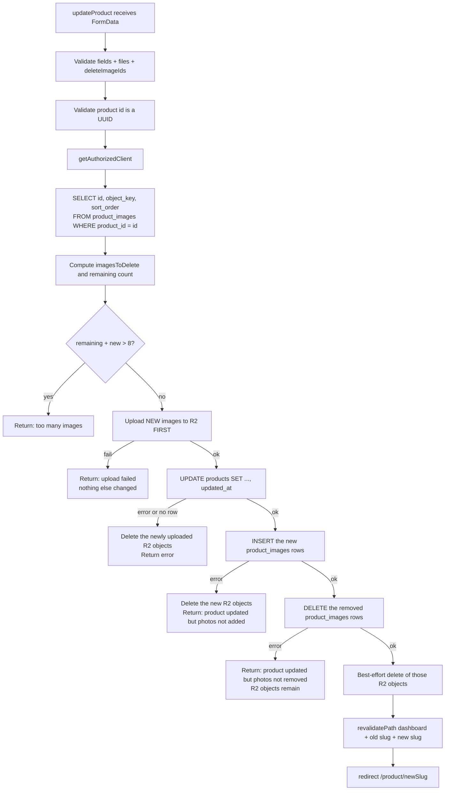
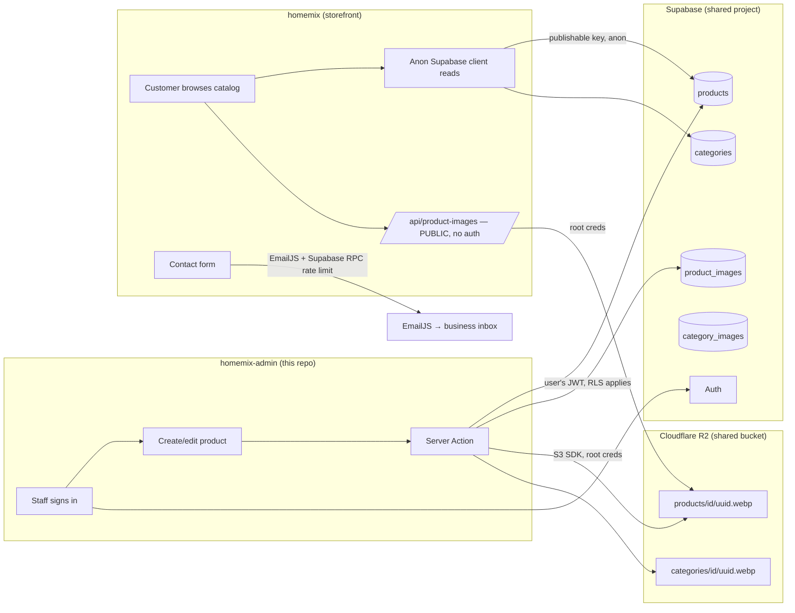

# ARCHITECTURE AUDIT — homemix-admin

**Audit date:** 2026-09-04
**Repository audited:** `C:\Users\KataNa\Desktop\homemix\homemix-admin` (git remote: `https://github.com/Kortua20/homemix-admin.git`, branch `main`, HEAD `111435f`)
**Related repository inspected for context:** `C:\Users\KataNa\Desktop\homemix\homemix` (git remote: `https://github.com/Kortua20/homemix.git`) — the public storefront
**Method:** static reading of all 149 tracked files in this repo, plus targeted reading of the sibling storefront repo where it shares the same database and object store. No code was modified, no packages installed, no runtime executed.

Throughout this document:

- **CONFIRMED** = directly evidenced by a file in one of the two repositories, with the file cited.
- **ASSUMED / ⚠️ NEEDS VERIFICATION** = a reasonable inference that the repository cannot prove. These require the Supabase dashboard, the Cloudflare dashboard, the Vercel dashboard, or the deployment environment to settle.

No secret values appear in this document. Environment variables are referenced **by name only**. (No `.env*` file exists in either working tree — `.gitignore` excludes `.env*`, and none was found on disk.)

---

# CURRENT ARCHITECTURE IN ONE PAGE

**Home Mix is a Georgian-language furniture business running on two separate Next.js 16 applications that share one Supabase Postgres database and one Cloudflare R2 bucket.**

This repository, `homemix-admin`, is the **private staff back-office**. It is not the customer-facing site.

```
                    ┌──────────────────────────────────────┐
   Staff  ────────► │  homemix-admin  (THIS REPO)          │
   (email +         │  Next.js 16 App Router               │
    password)       │  Sign in → Dashboard → CRUD          │
                    └───────────┬──────────────┬───────────┘
                                │              │
                    Supabase JS │              │ AWS S3 SDK
                    (user's JWT)│              │ (R2 root credentials)
                                ▼              ▼
                    ┌────────────────────┐  ┌──────────────────────┐
                    │ Supabase Postgres  │  │ Cloudflare R2 bucket │
                    │ products           │  │ products/<id>/*.webp │
                    │ categories         │  │ categories/<id>/*    │
                    │ product_images     │  │ (private bucket;     │
                    │ category_images    │  │  no public URL used) │
                    │ + Supabase Auth    │  └──────────────────────┘
                    └────────────────────┘             ▲
                                ▲                      │
                                │                      │
                    ┌───────────┴──────────────────────┴───────────┐
   Customers  ────► │  homemix  (SIBLING REPO — storefront)        │
                    │  Reads the same DB anonymously, streams the  │
                    │  same R2 objects publicly, sends contact     │
                    │  email via EmailJS                           │
                    └──────────────────────────────────────────────┘
```

**What this admin app actually does, in five sentences:**

1. A staff member signs in at `/` with email + password against **Supabase Auth**; the session lives in cookies managed by `@supabase/ssr`, refreshed on every request by `proxy.ts` (Next.js 16's renamed middleware).
2. Every page under `/dashboard`, `/product/*`, `/category/*`, `/categories` is a **React Server Component** that creates a per-request Supabase client carrying the user's JWT and queries Postgres directly — there is no separate API layer for reads.
3. All writes go through **Server Actions** (`app/product/actions.ts`, `app/categories/actions.ts`, `app/actions.ts`, `app/dashboard/actions.ts`) — there is no REST/GraphQL backend.
4. Product and category photos are optimized **in the browser** (canvas → WebP, target ~425 KB), uploaded through a Server Action, written to **Cloudflare R2** via the AWS S3 SDK, and recorded as a row in `product_images` / `category_images`; only the R2 object key is stored in Postgres.
5. Images are displayed by streaming them back through two **Route Handlers** (`/api/product-images/[id]`, `/api/category-images/[id]`) that check the session, look up the object key, fetch the object from R2 server-side, and pipe the bytes to the browser — the R2 bucket is never exposed directly.

**What this app does NOT do** (all verified by absence): it sends no email, it has no Cloudflare Workers/Pages/Images/Turnstile, it has no Supabase Storage buckets, it has no Supabase Edge Functions, it has no database migrations of its own, it has no tests, and it has no CI/CD configuration.

**The single most important thing to know before changing anything:** this application's security model rests entirely on **Row Level Security policies that live in the Supabase project, not in this repository.** The code authenticates ("is someone logged in?") but never authorizes ("is this person allowed to edit products?"). There is no role check, no admin table, no permission logic anywhere in the codebase. If RLS is not correctly configured in Supabase, any authenticated Supabase user — including one self-registered through the public storefront's anon key — could write to the product catalog. This cannot be verified from the repository and is the top item to check.

---

# 1. Executive Summary

`homemix-admin` is a small, coherent, recently-built Next.js 16 back-office application. It is roughly 3,900 lines of application code across ~40 TypeScript/TSX files, written in a consistent style with a clear separation between route pages (server), data normalization helpers (`lib/`), and interactive UI (client components). The code quality is above average for a project of this age: validation is present on every Server Action, error paths are handled with user-facing Georgian messages, and R2 uploads are cleaned up on failure with compensating deletes.

The architecture is deliberately thin. There is **no backend service** — Server Actions and Server Components talk to Supabase directly using the caller's own JWT, which is the intended `@supabase/ssr` pattern. The one piece of genuine infrastructure complexity is the image pipeline, which spans the browser (canvas optimization), a Server Action (upload), R2 (storage), Postgres (metadata), and a Route Handler (retrieval).

The user's stated beliefs were **partly incorrect**, and correcting them is a key output of this audit:

| Belief | Finding |
|---|---|
| "Built primarily with Next.js and Supabase" | **Confirmed** — Next.js 16.2.12, React 19.2.4, Supabase for Postgres + Auth. |
| "EmailJS may be used" | **Not in this repository.** EmailJS is used by the *sibling storefront* repo (`homemix`), server-side, in `app/api/contact/route.ts`. This admin app sends no email of any kind. |
| "Cloudflare may be involved" | **Confirmed, but not in the way usually meant.** Cloudflare **R2** is the primary object store for every product and category photo. There is no evidence of Workers, Pages, Images, Turnstile, or CDN configuration in the repository. |
| "Supabase Storage for images" (implied by the phase-5 brief) | **False.** No Supabase Storage bucket is referenced anywhere. All binary assets live in R2. |
| "Vercel is used" | **Cannot be confirmed from this repo.** No `vercel.json`, no `.vercel` directory, no `VERCEL_*` env usage in this repo. (The *storefront* repo does read `VERCEL_URL` and `VERCEL_PROJECT_PRODUCTION_URL`, which is strong evidence Vercel hosts at least the storefront.) |

The most significant risks are concentrated in three places: (1) **authorization is delegated entirely to unverifiable RLS**, (2) **R2 root credentials are used for per-request object reads**, making the image route a proxy over privileged credentials, and (3) **several multi-step write flows are not atomic**, so a partial failure can leave orphaned rows or orphaned R2 objects. None of these are five-alarm fires; all are worth resolving before the application grows.

---

# 2. Technology Stack

## 2.1 Framework — CONFIRMED

**Next.js 16.2.12**, App Router, React Server Components. ([package.json:20](package.json#L20))

This matters more than a version number normally would. Next.js 16 renamed Middleware to **Proxy**, and this project uses the new convention: the root file is [proxy.ts](proxy.ts), exporting a function named `proxy`, not `middleware.ts`. This is confirmed both by the file itself and by the bundled documentation at `node_modules/next/dist/docs/01-app/01-getting-started/16-proxy.md`, which states: *"Starting with Next.js 16, Middleware is now called Proxy to better reflect its purpose."* Any guidance you find online written for Next.js 13–15 middleware will name the wrong file.

The same doc carries a warning directly relevant to this codebase's security posture: *"Proxy is not intended for slow data fetching. While Proxy can be helpful for optimistic checks such as permission-based redirects, it should not be used as a full session management or authorization solution."* This project follows that advice correctly — proxy only refreshes the session; the actual gate is in layouts and actions.

## 2.2 Language — CONFIRMED

**TypeScript 5.x**, `strict: true`. ([tsconfig.json](tsconfig.json))

Notable settings: `target: ES2017`, `moduleResolution: "bundler"`, path alias `@/*` → project root (not `src/`, because this project has no `src/` directory). One build script is plain ESM JavaScript: [scripts/check-r2.mjs](scripts/check-r2.mjs).

Type safety has a real gap: there are **no generated Supabase types**. Every query result is hand-typed and force-cast, e.g. `normalizeProducts((data ?? []) as ProductQueryRow[])` in [app/dashboard/page.tsx:26](app/dashboard/page.tsx#L26). The database schema and the TypeScript types can drift apart silently. See §19.

## 2.3 Package manager — MIXED SIGNAL / ⚠️ NEEDS VERIFICATION

Both [pnpm-lock.yaml](pnpm-lock.yaml) (214,873 bytes, committed 2026-09-03) and [package-lock.json](package-lock.json) (333,717 bytes, **currently modified in the working tree** per `git status`) are present and tracked.

Two lockfiles for one project is a real hazard: they can resolve to different dependency trees, and whichever one the deployment platform picks up determines what actually ships. The npm lockfile being the one with uncommitted local modifications suggests `npm install` was run most recently. **This needs a decision, not just verification** — pick one package manager and delete the other lockfile.

## 2.4 Main dependencies — CONFIRMED ([package.json](package.json))

| Package | Version | Architectural role |
|---|---|---|
| `next` | 16.2.12 | Framework; App Router, Server Actions, Route Handlers |
| `react` / `react-dom` | 19.2.4 | `useActionState` throughout the form layer |
| `@supabase/supabase-js` | ^2.110.9 | Postgres client + Auth |
| `@supabase/ssr` | ^0.12.3 | Cookie-based session handling for SSR (`createServerClient`, `createBrowserClient`) |
| `@aws-sdk/client-s3` | ^3.1096.0 | S3-compatible client pointed at **Cloudflare R2** |
| `@aws-sdk/s3-request-presigner` | ^3.1096.0 | **Installed but never imported — see §19** |
| `@base-ui/react` | ^1.6.0 | **Installed but never imported — see §19** |
| `lucide-react` | ^1.27.0 | Icon set, used on every page |
| `tailwind-merge` + `clsx` | — | The `cn()` helper in [lib/utils.ts](lib/utils.ts) |
| `class-variance-authority` | ^0.7.1 | Variant styling in [components/ui/alert.tsx](components/ui/alert.tsx) and [button.tsx](components/ui/button.tsx) |
| `shadcn` | ^4.16.0 | Present as a runtime dep; supplies `shadcn/tailwind.css`, imported by [app/globals.css:3](app/globals.css#L3) |
| `tw-animate-css` | ^1.4.0 | Imported by [app/globals.css:2](app/globals.css#L2) |

## 2.5 Architecturally important dev dependencies — CONFIRMED

- `tailwindcss` ^4 + `@tailwindcss/postcss` — Tailwind **v4**, CSS-first configuration. There is no `tailwind.config.js`; theme tokens are declared in `@theme inline` inside [app/globals.css](app/globals.css). `components.json` confirms this with `"tailwind": { "config": "" }`.
- `eslint` ^9 + `eslint-config-next` 16.2.12 — flat config in [eslint.config.mjs](eslint.config.mjs).
- `@types/node` ^20 — note this is a major version behind the Node runtimes typically used with Next.js 16.

## 2.6 Build system — CONFIRMED ([package.json:5-10](package.json#L5-L10))

```
dev   → next dev
build → next build
start → next start
lint  → eslint
```

Four scripts, all Next.js defaults. **There is no `test` script and no test framework anywhere in the dependency tree.** There is also no script wired to [scripts/check-r2.mjs](scripts/check-r2.mjs), even though that script imports `@next/env` — a package that is *not* in `package.json` (it is available only transitively via `next`). Running that script is therefore fragile.

## 2.7 Configuration files — CONFIRMED

| File | Contents / purpose |
|---|---|
| [next.config.ts](next.config.ts) | **Only** sets `experimental.serverActions.bodySizeLimit: "45mb"`. This one line is load-bearing for the image upload flow — see §9. |
| [tsconfig.json](tsconfig.json) | Strict TS, `@/*` alias to project root. |
| [eslint.config.mjs](eslint.config.mjs) | Next core-web-vitals + TypeScript rules. |
| [postcss.config.mjs](postcss.config.mjs) | Tailwind v4 PostCSS plugin only. |
| [components.json](components.json) | shadcn config: style `base-nova`, base color `neutral`, RSC enabled, lucide icons, registry pointed at `https://supabase.com/ui/r/{name}.json`. |
| [proxy.ts](proxy.ts) | Next 16 Proxy (ex-Middleware). |
| [skills-lock.json](skills-lock.json) | AI agent tooling metadata (Supabase agent skills), not application code. |
| [AGENTS.md](AGENTS.md) / [CLAUDE.md](CLAUDE.md) | AI agent instructions, not application code. |

## 2.8 Deployment configuration — CONFIRMED ABSENT

No `vercel.json`. No `Dockerfile` or `docker-compose.*`. No `wrangler.toml`. No `.github/` directory. No `netlify.toml`. No `.vercel/` directory (it is gitignored, so absence from git proves nothing, but it is also absent from the working tree).

**There is zero deployment configuration in this repository.** See §12.

## 2.9 External services — CONFIRMED

Exactly two, both reached over the network at runtime:

1. **Supabase** — Postgres (via PostgREST) and Auth. Reached via `NEXT_PUBLIC_SUPABASE_URL`.
2. **Cloudflare R2** — S3-compatible object storage. Reached via `R2_ENDPOINT` or `https://<R2_ACCOUNT_ID>.r2.cloudflarestorage.com`.

Plus one build-time external dependency: **Google Fonts**, via `next/font/google` importing Manrope in [app/layout.tsx:2](app/layout.tsx#L2). (Interesting contrast: the sibling storefront self-hosts its fonts via `@fontsource-variable/*` packages. This admin app does not.)

---

# 3. Project Structure

## 3.1 Directory map

```
homemix-admin/
│
├── app/                      → Next.js App Router. Routes, layouts, Server Actions,
│   │                           and Route Handlers. All data reading happens here
│   │                           in Server Components; all writing happens in the
│   │                           four actions.ts files.
│   │
│   ├── actions.ts            → Sign-in Server Action. Validates email/password,
│   │                           calls supabase.auth.signInWithPassword, maps
│   │                           Supabase error codes to Georgian messages.
│   ├── layout.tsx            → Root layout. lang="ka", Manrope font, favicon.
│   ├── page.tsx              → "/" — the sign-in page. Redirects to /dashboard
│   │                           if already authenticated.
│   ├── globals.css           → Tailwind v4 entry + theme tokens (19 lines total).
│   │
│   ├── api/                  → The ONLY Route Handlers in the app. Both exist for
│   │   │                       one reason: to stream private R2 objects to the
│   │   │                       browser behind a session check.
│   │   ├── product-images/[id]/route.ts
│   │   └── category-images/[id]/route.ts
│   │
│   ├── dashboard/            → Product list. Also the home of the shared
│   │   ├── layout.tsx          DashboardLayout component (sidebar + mobile nav),
│   │   ├── page.tsx            which the /product and /category trees import
│   │   └── actions.ts          directly rather than nesting under.
│   │                           actions.ts holds only signOut().
│   │
│   ├── product/              → Product CRUD routes + all product write actions.
│   │   ├── layout.tsx          layout.tsx is the auth gate for this subtree.
│   │   ├── actions.ts          actions.ts = createProduct/updateProduct/deleteProduct
│   │   ├── new/page.tsx        (467 lines — the largest and most complex file).
│   │   └── [slug]/
│   │       ├── page.tsx      → product detail
│   │       ├── edit/page.tsx → product edit
│   │       └── not-found.tsx
│   │
│   ├── categories/           → Category LIST route (plural) + category write actions.
│   │   ├── layout.tsx          Note the split: /categories is the list,
│   │   ├── page.tsx            /category/* is the detail — see §3.3.
│   │   └── actions.ts        → createCategory/updateCategory/deleteCategory
│   │
│   └── category/             → Category detail/create/edit routes (singular).
│       ├── layout.tsx
│       ├── new/page.tsx
│       └── [slug]/{page,edit/page,not-found}.tsx
│
├── components/               → All UI. Split by feature, not by type.
│   ├── ui/                   → 4 shadcn primitives, 99 lines total:
│   │                           alert, button, input, label. Deliberately minimal.
│   ├── sign-in-form.tsx      → The only auth UI. Client component.
│   ├── dashboard/            → Shell navigation + the product grid.
│   │   ├── dashboard-navigation.tsx  (client — uses usePathname for active state)
│   │   ├── products-dashboard.tsx    (client — client-side search filter)
│   │   └── products/         → Card variants. desktop-product-card and
│   │                           mobile-product-card are BOTH rendered and
│   │                           toggled by CSS, not by JS — see §4.4.
│   ├── products/             → Product form, image field, delete dialog, types.
│   └── categories/           → Category equivalents of the above.
│
├── lib/                      → Non-UI logic. Four distinct concerns mixed
│   │                           into one flat folder:
│   ├── client.ts             │ (a) Supabase client factories — browser
│   ├── server.ts             │     server, and proxy variants.
│   ├── middleware.ts         │     NOTE: middleware.ts here is a LIB file,
│   │                         │     not a Next.js convention file.
│   ├── r2.ts                 │ (b) Cloudflare R2 access. "server-only".
│   ├── product-data.ts       │ (c) Query shapes + row→domain normalizers
│   ├── category-data.ts      │     + image URL builders.
│   ├── *-image-constraints.ts│ (d) Upload limits shared client↔server.
│   ├── product-image-optimization.ts │ Browser-only canvas resizing.
│   ├── slug.ts               │     Georgian-aware slug creation/validation.
│   └── utils.ts              │     cn() only.
│
├── scripts/
│   └── check-r2.mjs          → Standalone R2 credential/roundtrip diagnostic.
│                               Not wired to any npm script.
│
├── public/
│   └── logo.png              → The only static asset.
│
├── proxy.ts                  → Next 16 Proxy: refreshes the Supabase session
│                               on every non-static request.
│
└── .claude/ .agents/         → AI agent skill definitions (109 of the 149
                                tracked files). NOT application code.
```

## 3.2 A note on file counts

Of 149 tracked files, **109 are AI agent skill markdown files** under `.claude/skills/` and `.agents/skills/` — duplicated copies of the same Supabase skill packs. The actual application is ~40 files. When estimating the size of this codebase, ignore those directories entirely.

## 3.3 Structural observations

### 🔵 The `/categories` vs `/category` split is real, intentional, and confusing

Categories are served by **two separate route trees with two separate layouts**:

- [app/categories/](app/categories/) — the list page, at `/categories`
- [app/category/](app/category/) — detail, create, and edit, at `/category/[slug]`, `/category/new`

Products do not have this split: `/dashboard` is the list, `/product/*` is everything else. So the two features are structured *differently* for the same conceptual shape. [app/categories/layout.tsx](app/categories/layout.tsx) and [app/category/layout.tsx](app/category/layout.tsx) are byte-for-byte identical apart from the function name. This is the clearest naming inconsistency in the codebase. **CONFIRMED.**

### 🔵 `DashboardLayout` is imported as a component, not used as a nested layout

[app/dashboard/layout.tsx](app/dashboard/layout.tsx) is a Next.js layout file, but it is *also* imported directly as a React component by three sibling layouts:

```ts
// app/product/layout.tsx:3, app/category/layout.tsx:3, app/categories/layout.tsx:3
import DashboardLayout from "@/app/dashboard/layout";
```

This works, and it lets those layouts pass the non-standard `showAddProduct` prop that route-based nesting could not. But it means a file serving a framework convention is doing double duty as a shared component, and a reader following Next.js conventions will not expect it. It also means `DashboardLayout` receives a prop (`showAddProduct`) that Next.js itself would never pass. **CONFIRMED.**

### 🟡 Confirmed duplication

Three pairs of near-identical files exist because the category feature was built by copying the product feature ([commit cdefa19](https://github.com/Kortua20/homemix-admin/commit/cdefa19)):

| Product file | Category file | Divergence |
|---|---|---|
| [app/api/product-images/[id]/route.ts](app/api/product-images/[id]/route.ts) (72 lines) | [app/api/category-images/[id]/route.ts](app/api/category-images/[id]/route.ts) (69 lines) | Table name and type name only. Otherwise identical logic. |
| [app/product/actions.ts](app/product/actions.ts) (467 lines) | [app/categories/actions.ts](app/categories/actions.ts) (432 lines) | `uuidPattern`, `getAuthorizedClient`, `readDeletedImageIds`, `uploadImages`, and the error-code mapper are duplicated verbatim or near-verbatim. |
| [lib/product-data.ts](lib/product-data.ts) | [lib/category-data.ts](lib/category-data.ts) | `normalizeImage` + sort logic duplicated exactly. |
| [components/products/product-images-field.tsx](components/products/product-images-field.tsx) | [components/categories/category-images-field.tsx](components/categories/category-images-field.tsx) | Same structure; product version adds optimization + count cap. |

`getAuthorizedClient()` in particular is defined **twice**, identically, in two different actions files ([app/product/actions.ts:108](app/product/actions.ts#L108), [app/categories/actions.ts:84](app/categories/actions.ts#L84)). Since this function *is* the authorization check for the entire application, having two copies means a future security fix can be applied to one and forgotten in the other. **CONFIRMED.**

### 🔵 Dead / unused code

| Item | Evidence |
|---|---|
| `@aws-sdk/s3-request-presigner` | In [package.json:13](package.json#L13); zero imports anywhere (`grep` across `app/`, `lib/`, `components/`, `scripts/` returns nothing). Suggests presigned URLs were considered for image delivery and abandoned in favor of the proxy route. **CONFIRMED unused.** |
| `@base-ui/react` | In [package.json:14](package.json#L14); zero imports. The delete dialogs use raw `createPortal` instead ([components/products/delete-product-button.tsx:3](components/products/delete-product-button.tsx#L3)). **CONFIRMED unused.** |
| [scripts/check-r2.mjs](scripts/check-r2.mjs) | Functional and well-written, but referenced by no npm script and importing `@next/env`, which is not a declared dependency. **CONFIRMED orphaned.** |
| `MAX_PRODUCT_IMAGE_SOURCE_SIZE` server-side | Defined in [lib/product-image-constraints.ts:4](lib/product-image-constraints.ts#L4), enforced only in the client field, never in the Server Action. Not dead, but asymmetric. |
| `updated_at` on categories | [app/product/actions.ts:322](app/product/actions.ts#L322) sets `updated_at` on product updates; [app/categories/actions.ts:285](app/categories/actions.ts#L285) does not, and `categorySelect` never requests it. ⚠️ Whether the column exists on `categories` is unverified. |

### 🔵 Incomplete / experimental areas

- **No `error.tsx` or `loading.tsx` anywhere in this app.** The storefront repo has both ([app/error.tsx](../homemix/app/error.tsx), [app/product/[slug]/loading.tsx](../homemix/app/product/[slug]/loading.tsx)); the admin has neither. An unhandled render error in a Server Component will surface as the raw Next.js error boundary.
- **No `not-found.tsx` at the app root** — only per-segment ones for product and category.
- **No `README.md`** in this repo (the storefront has one, albeit the untouched create-next-app default).
- **No sitemap/robots/manifest** — correct for a private admin tool, noted only for completeness.

---

# 4. Frontend Architecture

## 4.1 Router — CONFIRMED: App Router

Exclusively App Router. There is no `pages/` directory. Every route is a directory under [app/](app/) containing `page.tsx`. Server Components are the default; client components opt in with `"use client"`.

## 4.2 Route map — CONFIRMED

| Route | File | Rendering | Auth gate | Purpose |
|---|---|---|---|---|
| `/` | [app/page.tsx](app/page.tsx) | Server | *Inverse* — redirects to `/dashboard` **if** authenticated | Sign-in page |
| `/dashboard` | [app/dashboard/page.tsx](app/dashboard/page.tsx) | Server | **In the page itself** (`redirect("/")`) | Product list + search |
| `/product/new` | [app/product/new/page.tsx](app/product/new/page.tsx) | Server | Via [app/product/layout.tsx](app/product/layout.tsx) | Create product form |
| `/product/[slug]` | [app/product/[slug]/page.tsx](app/product/[slug]/page.tsx) | Server | Via product layout | Product detail |
| `/product/[slug]/edit` | [app/product/[slug]/edit/page.tsx](app/product/[slug]/edit/page.tsx) | Server | Via product layout | Edit product |
| `/categories` | [app/categories/page.tsx](app/categories/page.tsx) | Server | Via [app/categories/layout.tsx](app/categories/layout.tsx) | Category list |
| `/category/new` | [app/category/new/page.tsx](app/category/new/page.tsx) | Server (static shell) | Via [app/category/layout.tsx](app/category/layout.tsx) | Create category |
| `/category/[slug]` | [app/category/[slug]/page.tsx](app/category/[slug]/page.tsx) | Server | Via category layout | Category detail |
| `/category/[slug]/edit` | [app/category/[slug]/edit/page.tsx](app/category/[slug]/edit/page.tsx) | Server | Via category layout | Edit category |
| `/api/product-images/[id]` | [route.ts](app/api/product-images/[id]/route.ts) | Route Handler, `force-dynamic`, nodejs runtime | **In the handler** (401) | Stream product image bytes |
| `/api/category-images/[id]` | [route.ts](app/api/category-images/[id]/route.ts) | Route Handler, `force-dynamic`, nodejs runtime | **In the handler** (401) | Stream category image bytes |

**Note the inconsistency:** `/dashboard` gates itself inside `page.tsx` ([app/dashboard/page.tsx:18-22](app/dashboard/page.tsx#L18-L22)) while every other protected area gates in `layout.tsx`. [app/dashboard/layout.tsx](app/dashboard/layout.tsx) performs **no auth check at all** — it is purely presentational. This works today because `/dashboard` has no child routes, but the moment someone adds `app/dashboard/settings/page.tsx`, that new route inherits an unguarded layout and would ship unprotected unless the author remembers to re-check. **CONFIRMED — this is a latent footgun, flagged in §18.**

## 4.3 Layout structure — CONFIRMED

```
app/layout.tsx  (RootLayout — <html lang="ka">, Manrope, no auth)
│
├── "/"  app/page.tsx  ─── standalone; renders its own <main>, no shell
│
└── Protected areas — each imports DashboardLayout as a component:
    │
    ├── app/dashboard/layout.tsx   ← THE SHELL ITSELF (no auth check)
    │   └── app/dashboard/page.tsx  (auth checked here)
    │
    ├── app/product/layout.tsx     (auth check) → <DashboardLayout showAddProduct={false}>
    ├── app/category/layout.tsx    (auth check) → <DashboardLayout showAddProduct={false}>
    └── app/categories/layout.tsx  (auth check) → <DashboardLayout showAddProduct={false}>
```

`DashboardLayout` renders: a fixed 256px desktop sidebar (logo, nav, "create product" CTA, sign-out form), a sticky mobile header, the page content, a desktop footer, a mobile FAB, and a fixed bottom mobile nav bar.

## 4.4 Reusable components — CONFIRMED

**UI primitives** ([components/ui/](components/ui/), 99 lines total) — `alert`, `button`, `input`, `label`, all shadcn-generated in the `base-nova` style using `class-variance-authority`.

**Feature components:**

- [components/sign-in-form.tsx](components/sign-in-form.tsx) — client; `useActionState(login)`; renders field-level and form-level errors with `aria-invalid`/`aria-describedby`.
- [components/dashboard/products-dashboard.tsx](components/dashboard/products-dashboard.tsx) — client; owns the search input state and filters the already-loaded array.
- [components/dashboard/products/{desktop,mobile}-product-card.tsx](components/dashboard/products/) — **server components** (no `"use client"`), rendered as siblings and toggled purely by Tailwind (`hidden lg:flex` vs `lg:hidden`).
- [components/dashboard/products/product-actions.tsx](components/dashboard/products/product-actions.tsx) — server; edit link + delete button, with a `compact` variant.
- [components/products/product-form.tsx](components/products/product-form.tsx) / [components/categories/category-form.tsx](components/categories/category-form.tsx) — client; the create/edit forms, mode-switched.
- [components/products/product-images-field.tsx](components/products/product-images-field.tsx) / [category-images-field.tsx](components/categories/category-images-field.tsx) — client; the most stateful components in the app.
- [components/{products,categories}/delete-*-button.tsx](components/products/delete-product-button.tsx) — client; portal-rendered confirmation dialogs.

## 4.5 UI / component library — CONFIRMED

**shadcn/ui** (style `base-nova`, base color `neutral`, CSS variables on) with **lucide-react** icons. Only four primitives have been generated; everything else is hand-written Tailwind. `@base-ui/react` is installed but unused — the dialogs are hand-rolled with `createPortal`.

## 4.6 Styling system — CONFIRMED

**Tailwind CSS v4**, CSS-first. [app/globals.css](app/globals.css) is only 19 lines: three imports (`tailwindcss`, `tw-animate-css`, `shadcn/tailwind.css`), a `@theme inline` block mapping `--font-sans` to the Manrope variable, and a small `@layer base`.

### 🟡 There is no design token layer

Every color in the application is an **inline hex literal** repeated across files:

- `#7f512f` (brand brown) — appears in at least 14 files
- `#fcf9f8` (page background), `#605e5b` (muted text), `#1b1c1c` (body text), `#d6c3b8` (border), `#c62828` (danger), `#83746b`, `#e4e2e1`, `#f0eded`, `#a89082`…
- Shadows are repeated as full literals: `shadow-[0_16px_30px_rgba(0,0,0,0.04)]` appears in ~10 files.

This is not a bug, and Tailwind v4 makes it easy to fix (`@theme` already exists in `globals.css`). But a rebrand today means a find-and-replace across the entire component tree, and there is no single place to see the palette. **CONFIRMED.**

## 4.7 State management — CONFIRMED

**No state management library.** None is needed at this size. The patterns in use:

1. **Server state** — fetched in Server Components on each request; `revalidatePath` in actions invalidates it.
2. **Form state** — `useActionState` (React 19) in all five forms; the action's return type doubles as the error model.
3. **Local UI state** — `useState` for dialog open/close, image selection, search query.
4. **Derived state** — computed inline rather than stored. [components/dashboard/products-dashboard.tsx:29-34](components/dashboard/products-dashboard.tsx#L29-L34) uses `useDeferredValue` for the search filter, which is the right call.

There is exactly one `useEffect` in the app's client components, and it is used correctly — for cleanup of object URLs on unmount ([components/products/product-images-field.tsx:98-105](components/products/product-images-field.tsx#L98-L105)). This is a genuinely good sign about the codebase.

## 4.8 Form handling — CONFIRMED

Progressive-enhancement-friendly: every form uses `<form action={serverAction}>` with `useActionState`, so it degrades to a native POST without JS. Validation is duplicated deliberately:

- **Client** — HTML attributes (`required`, `minLength`, `maxLength`, `pattern`, `type="number"`, `step`) for immediate feedback.
- **Server** — full re-validation in `readProductFields` / `readCategoryFields`. The server never trusts the client.

Field errors are returned as a `fieldErrors` object and rendered next to the offending input with proper ARIA wiring.

### 🔵 An interesting hack worth knowing about

The image fields manipulate a real `<input type="file">` via the `DataTransfer` API so that the browser-optimized `File` objects — not the originals the user picked — are what the form actually submits:

```ts
// components/products/product-images-field.tsx:107-115
function syncInputFiles(files: File[]) {
  const transfer = new DataTransfer();
  files.forEach((file) => transfer.items.add(file));
  inputRef.current.files = transfer.files;
}
```

This is clever and it works, but it is unusual, browser-API-dependent, and completely undocumented in the code. Anyone refactoring the image field needs to understand this or they will silently break the upload. **CONFIRMED.**

## 4.9 Server vs Client components — CONFIRMED

**Server (default)** — all 11 page/layout files, both route handlers, `product-actions.tsx`, and both product cards. Data fetching and auth checks happen exclusively here.

**Client (`"use client"`, 8 files)** — `sign-in-form`, `dashboard-navigation` (needs `usePathname`), `products-dashboard` (search state), `product-form`, `category-form`, `product-images-field`, `category-images-field`, `delete-product-button`, `delete-category-button`, `categories-manager`.

The boundary is drawn sensibly: interactivity is pushed to leaves, and the pages that fetch data stay on the server.

### 🟡 One boundary looks misplaced

[components/categories/categories-manager.tsx](components/categories/categories-manager.tsx) is marked `"use client"` but contains **no state, no effects, and no event handlers**. Its only interactive child is `DeleteCategoryButton`, which is already a client component in its own right. The `"use client"` directive appears unnecessary and pulls the whole category grid into the client bundle. Compare with `products-dashboard.tsx`, which genuinely needs it for the search input. **CONFIRMED — low-impact, easy win.**

## 4.10 Data fetching patterns — CONFIRMED

Three patterns, in order of frequency:

1. **Direct query in a Server Component** — the norm. E.g. [app/dashboard/page.tsx:24-27](app/dashboard/page.tsx#L24-L27).
2. **Parallel queries with `Promise.all`** — used once, correctly, in [app/product/[slug]/edit/page.tsx:30-38](app/product/[slug]/edit/page.tsx#L30-L38) to fetch the product and the category list simultaneously.
3. **Nested-relation selects** — `productSelect` in [lib/product-data.ts:7-28](lib/product-data.ts#L7-L28) pulls product + category + all images in **one** PostgREST request, explicitly naming the FK (`categories!products_category_id_fkey`). This avoids N+1 and is the right approach.

Results are always run through a `normalize*` function that converts snake_case DB rows to camelCase domain objects, coerces `price`/`size_bytes` from PostgREST's string-or-number to `number`, and sorts images by `sort_order` then `created_at`.

**No caching is configured anywhere.** No `revalidate` exports, no `unstable_cache`, no `fetch` cache options. Because every page calls `cookies()` (through `createClient`), all pages are dynamically rendered on every request. For an admin tool with a handful of users this is correct and desirable — freshness beats speed here.

## 4.11 How product data reaches the UI — CONFIRMED

```
Browser requests /dashboard
   ↓
proxy.ts → updateSession() refreshes the Supabase auth cookies
   ↓
app/dashboard/page.tsx (Server Component)
   ├─ createClient()            → server Supabase client bound to the request's cookies
   ├─ supabase.auth.getClaims() → if no claims, redirect("/")
   └─ .from("products").select(productSelect).order("created_at", desc)
   ↓
normalizeProducts(rows)  →  Product[]  (camelCase, numeric price, sorted images)
   ↓
<ProductsDashboard products={products} loadError={...} />   ← serialized to the client
   ↓
client-side filter by name (useDeferredValue)
   ↓
<DesktopProductCard> + <MobileProductCard>  (both rendered, CSS-toggled)
   ↓
  →  "/api/product-images/<uuid>"
   ↓
Route Handler re-checks the session, resolves object_key from Postgres,
fetches the object from R2, returns the bytes
```

---

# 5. Backend Architecture

There is **no separate backend**. The "backend" of this application is three Next.js mechanisms running in the same deployment.

## 5.1 What exists — CONFIRMED

| Mechanism | Present? | Where |
|---|---|---|
| Server Actions | ✅ Yes — 8 of them | `app/actions.ts`, `app/dashboard/actions.ts`, `app/product/actions.ts`, `app/categories/actions.ts` |
| Route Handlers | ✅ Yes — 2 | `app/api/{product,category}-images/[id]/route.ts` |
| Proxy (ex-Middleware) | ✅ Yes — 1 | `proxy.ts` |
| Next.js Pages API routes | ❌ No | no `pages/` dir |
| Supabase Edge Functions | ❌ No | no `supabase/functions/` in this repo |
| Supabase Database Functions (RPC) | ❌ Not called from this repo | *(the storefront calls two — see §6)* |
| External backend API | ❌ No | the only outbound calls are Supabase + R2 |

## 5.2 Server Actions in detail — CONFIRMED

### `login` — [app/actions.ts:18](app/actions.ts#L18)
- **Called by:** [components/sign-in-form.tsx:17](components/sign-in-form.tsx#L17) via `useActionState`.
- **Receives:** `FormData` with `email`, `password`.
- **Does:** trims/validates email against a regex, requires non-empty password, calls `supabase.auth.signInWithPassword`, maps `invalid_credentials` / `email_not_confirmed` / `user_banned` / `over_request_rate_limit` to distinct Georgian messages.
- **Returns:** `LoginState` on failure; on success `revalidatePath("/", "layout")` then `redirect("/dashboard")`.

### `signOut` — [app/dashboard/actions.ts:7](app/dashboard/actions.ts#L7)
- **Called by:** the sign-out `<form>` in [app/dashboard/layout.tsx:47](app/dashboard/layout.tsx#L47).
- **Does:** `supabase.auth.signOut()` then `redirect("/")`. No auth check needed.

### `createProduct` — [app/product/actions.ts:169](app/product/actions.ts#L169)
- **Called by:** [components/products/product-form.tsx:31](components/products/product-form.tsx#L31) when `mode === "create"`.
- **Receives:** `name`, `slug`, `description`, `price`, `categoryId`, `images[]` (File objects), from `FormData`.
- **Does:** validate fields → validate image files (count ≤ 8, MIME in {jpeg,png,webp}, each ≤ 5 MB, total ≤ 3.5 MB) → `getAuthorizedClient()` → insert into `products` → upload each file to R2 → insert rows into `product_images`. **On any image failure it compensates**: deletes the uploaded R2 objects *and* deletes the just-created product row ([lines 221-234](app/product/actions.ts#L221-L234)).
- **Returns:** `ProductActionState` on error; on success `revalidatePath("/dashboard")` then redirects to the new product.

### `updateProduct` — [app/product/actions.ts:240](app/product/actions.ts#L240)
The most complex function in the codebase. Order of operations: validate → authorize → read current images → compute deletions and the resulting count (rejecting if > 8) → **upload new images to R2 first** → update the `products` row → insert new `product_images` rows → delete removed `product_images` rows → delete those objects from R2 → revalidate three paths → redirect. Failures at each stage attempt to roll back the R2 uploads.

### `deleteProduct` — [app/product/actions.ts:398](app/product/actions.ts#L398)
Validate UUID → authorize → **read all `object_key`s first** → delete the product row (relying on `ON DELETE CASCADE` for `product_images`) → best-effort delete the R2 objects. `redirectAfterDelete` (a form field) controls whether it redirects or returns a success state for the dialog to display.

### `createCategory` / `updateCategory` / `deleteCategory` — [app/categories/actions.ts](app/categories/actions.ts)
Structurally identical to the product trio, with these differences: category names must contain at least one Georgian character (`georgianPattern`, [line 27](app/categories/actions.ts#L27)); there is **no image count cap** and **no total-upload-size cap**; and `updated_at` is not set on update.

## 5.3 Route Handlers in detail — CONFIRMED

Both image routes ([product](app/api/product-images/[id]/route.ts), [category](app/api/category-images/[id]/route.ts)) are `runtime = "nodejs"` (required — the AWS SDK is not edge-compatible) and `dynamic = "force-dynamic"`.

Flow: validate the `[id]` param against the UUID regex (404 if bad) → `createClient()` → `getClaims()`, rejecting on error, missing `sub`, or `is_anonymous` (**401**) → select `object_key, original_name, content_type` from the images table (404 if missing) → `getR2Object(object_key)` → buffer the entire body into memory → return with `Cache-Control: private, max-age=3600`, `Content-Disposition: inline`, `X-Content-Type-Options: nosniff`.

## 5.4 Backend flow map

```
┌─────────────────────────────────────────────────────────────────────┐
│                          EVERY REQUEST                              │
│  proxy.ts (matcher excludes _next/static, _next/image, images)      │
│      └─► lib/middleware.ts :: updateSession()                       │
│              └─► createServerClient + getClaims()                   │
│                  refreshes auth cookies onto the response           │
│              ⚠ performs NO redirect and NO route protection         │
└─────────────────────────────────────────────────────────────────────┘
         │
         ├── READS ──────────────────────────────────────────────────┐
         │   Server Component                                        │
         │     └─ lib/server.ts :: createClient()  (user's JWT)      │
         │         └─ supabase.from(...).select(...)                 │
         │             └─ PostgREST ──► Postgres (RLS applies)       │
         └───────────────────────────────────────────────────────────┘
         │
         ├── WRITES ─────────────────────────────────────────────────┐
         │   Client form ──POST──► Server Action                     │
         │     1. validate FormData (types, lengths, MIME, sizes)    │
         │     2. getAuthorizedClient()  ← THE authorization check   │
         │     3. supabase.from(...).insert/update/delete            │
         │     4. lib/r2.ts :: upload / delete objects               │
         │     5. compensating cleanup on failure                    │
         │     6. revalidatePath(...) + redirect(...)                │
         └───────────────────────────────────────────────────────────┘
         │
         └── IMAGE BYTES ────────────────────────────────────────────┐
                               │
               └─ Route Handler                                      │
                   1. UUID format check              → 404           │
                   2. getClaims() session check      → 401           │
                   3. SELECT object_key FROM ...     → 404           │
                   4. lib/r2.ts :: getR2Object()  (root creds)       │
                   5. buffer → Response(bytes)                       │
             ──────────────────────────────────────────────────────  ┘
```

---

# 6. Supabase Architecture

## 6.1 Client construction — CONFIRMED

Three factories, all using `NEXT_PUBLIC_SUPABASE_URL` + `NEXT_PUBLIC_SUPABASE_PUBLISHABLE_KEY`:

| File | Function | Used by |
|---|---|---|
| [lib/server.ts](lib/server.ts) | `createClient()` — `createServerClient` bound to `cookies()` | Every Server Component, every Server Action, both Route Handlers |
| [lib/middleware.ts](lib/middleware.ts) | `updateSession(request)` — `createServerClient` bound to request/response cookies | [proxy.ts](proxy.ts) |
| [lib/client.ts](lib/client.ts) | `createClient()` — `createBrowserClient` | **Nothing. Zero imports.** |

### 🔵 `lib/client.ts` is entirely unused — CONFIRMED

A `grep` for imports of `@/lib/client` across `app/`, `components/`, and `lib/` returns no results. This is actually a *good* architectural signal: no client component talks to Supabase directly; all database access is server-side. But the file is dead code that implies a capability the app does not use.

**Note the key naming:** `NEXT_PUBLIC_SUPABASE_PUBLISHABLE_KEY`, not the older `NEXT_PUBLIC_SUPABASE_ANON_KEY`. This is Supabase's newer publishable-key scheme. **There is no `SUPABASE_SERVICE_ROLE_KEY` anywhere in this repository** — a deliberate and correct choice, since it means no code path can bypass RLS.

## 6.2 Database — tables referenced in code

All four are **CONFIRMED as referenced**; their exact column definitions are **⚠️ NEEDS VERIFICATION** because no migration or generated type file exists in this repo.

### `products`
Referenced in [app/product/actions.ts](app/product/actions.ts), [app/dashboard/page.tsx](app/dashboard/page.tsx), [app/product/[slug]/page.tsx](app/product/[slug]/page.tsx), [lib/product-data.ts](lib/product-data.ts).

Columns evidenced by reads/writes: `id` (uuid, PK), `slug` (text, unique — inferred from the `23505` handler at [line 154](app/product/actions.ts#L154)), `name` (text), `description` (text), `price` (numeric — arrives as string or number, coerced at [lib/product-data.ts:76](lib/product-data.ts#L76)), `category_id` (uuid, FK → `categories.id`, constraint named `products_category_id_fkey`, evidenced by [lib/product-data.ts:14](lib/product-data.ts#L14)), `created_at`, `updated_at` (timestamptz — set manually by the app, not by a trigger).

### `categories`
Columns evidenced: `id`, `slug` (unique), `name` (likely also unique — the `23505` message at [app/categories/actions.ts:131](app/categories/actions.ts#L131) says *"a catalog with this name or slug already exists"*), `description`. **No `created_at`/`updated_at` is ever selected or written** — ⚠️ unverified whether they exist.

### `product_images`
Columns evidenced: `id` (uuid), `product_id` (uuid, FK → `products.id`), `object_key` (text — the R2 key), `original_name` (text), `content_type` (text), `size_bytes` (numeric/bigint — coerced), `sort_order` (int), `created_at`.

### `category_images`
Same shape with `category_id` instead of `product_id`.

## 6.3 Inferred relationships



### Two important constraint inferences

**`ON DELETE CASCADE` on the image FKs — ASSUMED, load-bearing.**
`deleteProduct` reads the object keys, then deletes only the `products` row ([app/product/actions.ts:429-434](app/product/actions.ts#L429-L434)). It never deletes from `product_images`. If cascade is *not* configured, either the delete fails with a `23503` FK violation (visible, safe) or orphan image rows accumulate. **⚠️ NEEDS VERIFICATION.**

**`ON DELETE RESTRICT`/`NO ACTION` on `products.category_id` — ASSUMED, and intentional.**
[app/categories/actions.ts:138-140](app/categories/actions.ts#L138-L140) maps error `23503` to *"this catalog is used by products and cannot be deleted yet"*. That message only makes sense if the FK blocks the delete. **⚠️ NEEDS VERIFICATION.**

## 6.4 Important queries — CONFIRMED

The single most performance-relevant query is the dashboard load ([app/dashboard/page.tsx:24](app/dashboard/page.tsx#L24) with `productSelect`): it fetches **every product, with its category and all its images, unpaginated, ordered by `created_at` desc**. See §18 for why this matters.

Slug lookups (`.eq("slug", slug).maybeSingle()`) appear on four routes and are the second most common shape.

## 6.5 Authentication

### Is Supabase Auth used? — CONFIRMED: yes, exclusively.

### Methods — CONFIRMED: email + password only.
`signInWithPassword` at [app/actions.ts:74](app/actions.ts#L74) is the only sign-in call in the codebase. There is **no** OAuth, no magic link, no OTP, no MFA, **no sign-up flow, no password reset flow, and no user-management UI**. Accounts must be provisioned manually in the Supabase dashboard. **⚠️ How staff accounts are actually created is unverifiable from the repo.**

### Session handling — CONFIRMED
Cookie-based via `@supabase/ssr`. [lib/server.ts](lib/server.ts) wires Supabase's `getAll`/`setAll` to Next's `cookies()`, with the `setAll` failure swallowed in a `try/catch` — correct, because Server Components cannot set cookies, and the proxy handles refresh instead.

The app consistently uses **`getClaims()`** rather than `getUser()` or `getSession()`. `getClaims()` verifies the JWT (locally against the project's JWKS when using asymmetric keys, otherwise via the Auth server), so it is a safe basis for authorization — unlike `getSession()`, which trusts unverified cookie contents.

### Is the proxy involved? — CONFIRMED: yes, but only for refresh.

[proxy.ts](proxy.ts) matches everything except `_next/static`, `_next/image`, `favicon.ico`, and image file extensions, and delegates to `updateSession`. That function creates a Supabase client, calls `getClaims()`, and returns the response with refreshed cookies.

**It performs no redirect and enforces no access control.** The comments in [lib/middleware.ts](lib/middleware.ts) are the stock Supabase template comments; the template's usual "if no user, redirect to /login" block has been removed. Every protected route therefore does its own check. This is consistent with the Next.js 16 guidance quoted in §2.1, and it is the *safer* of the two patterns — but it means route protection is opt-in per file rather than default-deny. See §18.

### Protected routes — CONFIRMED

| Location | Check | Failure |
|---|---|---|
| [app/page.tsx:9-13](app/page.tsx#L9-L13) | `if (data?.claims)` | redirect → `/dashboard` (inverse gate) |
| [app/dashboard/page.tsx:18-22](app/dashboard/page.tsx#L18-L22) | `if (!authData?.claims)` | redirect → `/` |
| [app/product/layout.tsx:11-15](app/product/layout.tsx#L11-L15) | `if (!data?.claims)` | redirect → `/` |
| [app/category/layout.tsx:11-15](app/category/layout.tsx#L11-L15) | `if (!data?.claims)` | redirect → `/` |
| [app/categories/layout.tsx:11-15](app/categories/layout.tsx#L11-L15) | `if (!data?.claims)` | redirect → `/` |
| Both image Route Handlers | `getClaims()` + `!is_anonymous` | HTTP 401 |
| All 6 CRUD Server Actions | `getAuthorizedClient()` | error state returned to the form |

Note the **stricter** check in the actions and route handlers versus the pages: actions reject `is_anonymous === true` and require `claims.sub`, while the page-level gates only test `data?.claims` truthiness. An anonymous Supabase session would pass the *page* gate and see the dashboard shell, but be rejected by every action and every image request. Minor inconsistency, low practical impact unless anonymous sign-in is enabled in the Supabase project (**⚠️ unverified**).

## 6.6 Storage — CONFIRMED: Supabase Storage is NOT used

There is not a single reference to `supabase.storage`, `.from("<bucket>")` on the storage client, `getPublicUrl`, or `createSignedUrl` anywhere in either repository. **All binary assets live in Cloudflare R2.** See §9.

## 6.7 Security posture

### 🔴 Row Level Security: assumed, unverifiable from this repo, and load-bearing

This is the central security fact of the application.

The app **only ever uses the publishable (anon) key** with the end user's JWT. It never uses a service-role key. Therefore **every database operation is subject to RLS**, and RLS is the *only* thing standing between an authenticated user and the product catalog.

The code's own comments show the author expected this. On failed writes it reports *"product not found **or you don't have permission to change it**"* ([app/product/actions.ts:345](app/product/actions.ts#L345), [line 446](app/product/actions.ts#L446)) — a message that only makes sense if RLS may silently filter the row.

But **there are no migrations, no SQL files, no policy definitions, and no generated types in this repository.** The actual policies cannot be read. What can be said:

- If RLS is enabled with policies like `to authenticated using (true)`, then **any** authenticated Supabase user in this project can create, edit, and delete products — including a user who self-registered through the public storefront, which shares the same Supabase project and uses the same publishable key.
- If RLS is enabled but has *no* policies for `authenticated`, every write would fail and the admin app would be non-functional — which it evidently is not.
- If RLS is disabled on these tables, the publishable key alone grants full access to anyone on the internet.

**⚠️ NEEDS VERIFICATION — highest priority item in this audit.** See §18-🔴-1.

### 🟠 No roles, no admin concept — CONFIRMED

`grep` finds no reference to `role`, `is_admin`, `app_metadata`, `user_metadata`, a `profiles` table, or any permission check. `getAuthorizedClient()` ([app/product/actions.ts:108-121](app/product/actions.ts#L108-L121)) checks exactly three things: no error, `claims.sub` exists, `is_anonymous !== true`. **"Authenticated" is treated as synonymous with "administrator."**

### Cross-repo finding: `product_images` is publicly readable — CONFIRMED

The storefront repo contains this migration ([supabase/migrations/20260801123141_allow_public_product_image_reads.sql](../homemix/supabase/migrations/20260801123141_allow_public_product_image_reads.sql)):

```sql
grant select on table public.product_images to anon, authenticated;
alter table public.product_images enable row level security;
create policy "Product images are publicly readable"
on public.product_images for select to anon, authenticated using (true);
```

This **confirms** that (a) RLS *is* enabled on at least `product_images`, (b) migrations for this shared database live in the **storefront** repo, not here, and (c) anyone with the publishable key can read every row of `product_images`, including `object_key`. The admin's 401 check on `/api/product-images/[id]` is therefore a control on the *proxy route*, not on the underlying metadata — the metadata is public by design, because the storefront needs it.

**⚠️ The equivalent policies for `products`, `categories`, and `category_images` are not in either repo and must be read from the Supabase dashboard.**

---

# 7. Authentication & Authorization

## 7.1 Authentication flow — CONFIRMED

```mermaid
sequenceDiagram
    participant U as Staff member
    participant P as app/page.tsx (RSC)
    participant F as SignInForm (client)
    participant A as login action
    participant S as Supabase Auth
    participant X as proxy.ts

    U->>P: GET /
    P->>S: getClaims()
    alt already signed in
        P-->>U: redirect /dashboard
    else not signed in
        P-->>U: render SignInForm
    end

    U->>F: submits email + password
    F->>A: useActionState → POST Server Action
    A->>A: validate email regex, non-empty password
    A->>S: signInWithPassword(email, password)

    alt failure
        S-->>A: AuthError (invalid_credentials | email_not_confirmed | user_banned | over_request_rate_limit)
        A-->>F: LoginState { message } → rendered in an Alert
    else success
        S-->>A: session; @supabase/ssr writes auth cookies
        A->>A: revalidatePath("/", "layout")
        A-->>U: redirect /dashboard
    end

    Note over U,X: On every subsequent request
    U->>X: GET /any-protected-route
    X->>S: getClaims()  (refresh)
    X-->>U: response carrying refreshed cookies
    Note over X: proxy does NOT redirect — the layout/page does the gating
```

## 7.2 Authorization model — CONFIRMED (and it is thin)

```
Layer 1 — proxy.ts
    Refreshes cookies. Enforces nothing.

Layer 2 — Layouts & pages
    if (!claims) redirect("/")
    Answers: "is anyone signed in?"  →  Blocks anonymous browsing of the UI.

Layer 3 — Server Actions & Route Handlers
    getAuthorizedClient(): no error && claims.sub && !is_anonymous
    Answers: "is anyone signed in?"  →  Same question, stricter test.

Layer 4 — Postgres RLS  ⚠️ NOT IN THIS REPOSITORY
    The ONLY layer that could answer "is THIS person allowed to do THIS?"
```

Layers 1–3 contain **no** authorization logic — only authentication checks. All genuine authorization is delegated to layer 4, which is invisible to this codebase.

For a single-operator internal tool this is a defensible design. It becomes a problem the moment a second class of user exists, or the moment the shared Supabase project allows public sign-up.

---

# 8. Database Understanding

**Everything in this section about column types and constraints is INFERRED from application code. No schema file exists in this repository.** The only SQL in either repo is four migration files in the storefront, and none of them create these tables — they only add policies and a rate-limiting function.

## 8.1 Constraint evidence from error handling — CONFIRMED as handled, ASSUMED as to what they map to

[app/product/actions.ts:153-167](app/product/actions.ts#L153-L167) and [app/categories/actions.ts:129-143](app/categories/actions.ts#L129-L143) map Postgres SQLSTATE codes:

| Code | Meaning | What the app infers |
|---|---|---|
| `23505` | unique_violation | `products.slug` is unique; `categories.name` and/or `categories.slug` are unique |
| `23503` | foreign_key_violation | `products.category_id` → `categories.id` exists and restricts category deletion |
| `23514` | check_violation | Some CHECK constraint exists (likely on `price`) |
| `22003` | numeric_value_out_of_range | `price` is a bounded numeric — the app validates `≤ 9,999,999,999.99` at [line 61](app/product/actions.ts#L61), suggesting `numeric(12,2)` |

The fact that the developer wrote handlers for these specific codes is good evidence the constraints exist. It is not proof of their exact definitions.

## 8.2 Application-level validation (the real, verifiable contract) — CONFIRMED

| Field | Rule | Source |
|---|---|---|
| product.name | 2–160 chars, whitespace collapsed | [app/product/actions.ts:43](app/product/actions.ts#L43) |
| product.slug | 2–160 chars, matches `^[a-z0-9\u10a0-\u10ff]+(-[a-z0-9\u10a0-\u10ff]+)*$` | [lib/slug.ts:2](lib/slug.ts#L2) |
| product.description | ≤ 5000 chars, optional | [app/product/actions.ts:53](app/product/actions.ts#L53) |
| product.price | finite, ≥ 0, ≤ 9,999,999,999.99 | [app/product/actions.ts:57-62](app/product/actions.ts#L57-L62) |
| product.category_id | must match the UUID regex | [app/product/actions.ts:66](app/product/actions.ts#L66) |
| category.name | 2–80 chars, **must contain a Georgian character** | [app/categories/actions.ts:37-41](app/categories/actions.ts#L37-L41) |
| category.slug | 2–80 chars, same slug pattern | [app/categories/actions.ts:43](app/categories/actions.ts#L43) |

The slug system is genuinely well-considered: [lib/slug.ts](lib/slug.ts) normalizes with NFKC, lowercases with the `"ka"` locale, and permits the Georgian Unicode block `\u10a0-\u10ff` alongside ASCII. `decodeSlugParam` handles percent-encoded Georgian in URLs.

### 🟡 One normalization mismatch across repos — CONFIRMED

The admin normalizes slugs to **NFKC** ([lib/slug.ts:14](lib/slug.ts#L14)); the storefront normalizes to **NFC** ([../homemix/lib/storefront.ts](../homemix/lib/storefront.ts), `normalizeSlug`). For Georgian text these almost always agree, but they are not the same function, and a slug containing a compatibility character could resolve on one site and 404 on the other. Low probability, easy to align.

---

# 9. Storage & Image Architecture

This is the most distinctive part of the system and deserves close reading.

## 9.1 Where images live — CONFIRMED

**Cloudflare R2**, accessed through the AWS S3 SDK. Not Supabase Storage. Not the local filesystem. Not Cloudflare Images.

[lib/r2.ts](lib/r2.ts) is marked `import "server-only"` — a compile-time guarantee that R2 credentials can never be bundled into client JavaScript. Good.

Configuration ([lib/r2.ts:27-38](lib/r2.ts#L27-L38)):
- `R2_BUCKET_NAME`, `R2_ACCESS_KEY_ID`, `R2_SECRET_ACCESS_KEY` — all required
- `R2_ENDPOINT` — used if set; otherwise derived as `https://${R2_ACCOUNT_ID}.r2.cloudflarestorage.com`
- `region: "auto"` (the R2 convention)
- Throws `R2_CONFIGURATION_MISSING` if any is absent
- The `S3Client` is cached in a module-level variable (`cachedConfig`) — fine for a single-region S3 client

## 9.2 Object key scheme — CONFIRMED

```
products/<productId>/<random-uuid>.<jpg|png|webp>
categories/<categoryId>/<random-uuid>.<jpg|png|webp>
```

Built at [lib/r2.ts:71](lib/r2.ts#L71) using `crypto.randomUUID()`. The extension comes from a MIME allowlist (`imageExtensions`), so an unknown content type throws `UNSUPPORTED_IMAGE` rather than producing a key with an attacker-chosen extension. Objects are written with `CacheControl: "private, max-age=3600"` and the URL-encoded original filename in S3 metadata.

## 9.3 Are images public or protected? — CONFIRMED: both, depending on which app serves them

**This is the subtlety that matters most.**

- **The R2 bucket itself is never exposed.** No public R2 URL, no custom domain, no presigned URL is generated anywhere. Both applications proxy every byte through their own server.
- **In the admin**, the proxy route requires a valid non-anonymous session and returns 401 otherwise, with `Cache-Control: private, max-age=3600` ([app/api/product-images/[id]/route.ts:57](app/api/product-images/[id]/route.ts#L57)).
- **In the storefront**, the equivalent route ([../homemix/app/api/product-images/[id]/route.ts](../homemix/app/api/product-images/[id]/route.ts)) performs **no auth check at all** and serves with `Cache-Control: public, max-age=86400, s-maxage=604800, stale-while-revalidate=86400`.

So the same R2 object is private through the admin and public through the storefront. That is correct for a shop — customers must see product photos — but it means **the admin's 401 provides no real confidentiality**: anyone who knows an image UUID can fetch the same bytes from the storefront without authenticating. Since `product_images` is `select`-able by `anon` (§6.7), the UUIDs are discoverable too. Worth understanding before treating the admin's image route as a security boundary. **CONFIRMED.**

## 9.4 Client-side image optimization — CONFIRMED

[lib/product-image-optimization.ts](lib/product-image-optimization.ts) runs **in the browser**, before upload. It is the most sophisticated single file in the repo:

1. Skip entirely if the file is already ≤ 425 KB and is not HEIC/HEIF.
2. Decode via `createImageBitmap` with `imageOrientation: "from-image"`; fall back to an `` element — with an explicit comment that Safari can decode some camera formats the bitmap path cannot.
3. Scale down so the longest edge is ≤ 1920 px.
4. Try up to **seven** (scale, quality) combinations, encoding to WebP with a JPEG fallback, stopping at the first result ≤ 425 KB and otherwise keeping the smallest.
5. Return a new `File` with the correct MIME type and extension.

The purpose is not just bandwidth — it is a workaround for the Server Action body limit (§9.6). It also silently converts iPhone HEIC photos to WebP, which is why the file input accepts HEIC/HEIF ([lib/product-image-constraints.ts:8](lib/product-image-constraints.ts#L8)) even though the *server* rejects those MIME types ([line 13](lib/product-image-constraints.ts#L13)).

### 🟡 Categories get none of this — CONFIRMED

[components/categories/category-images-field.tsx](components/categories/category-images-field.tsx) does **not** import `optimizeProductImage`. Category images are uploaded at full original size (up to 5 MB each), with **no count limit and no total-size limit** on either the client or the server ([app/categories/actions.ts:57-70](app/categories/actions.ts#L57-L70)). A user selecting eight 5 MB category photos would send a 40 MB Server Action body — just under the 45 MB cap, but far above the product path's 3.5 MB budget, and likely to fail on a platform with a lower request limit.

## 9.5 The upload/serve pipelines

### Upload

```
User picks files in <input type="file" accept="jpeg,png,webp,heic,heif">
   ↓  (client)
Reject if > 8 total, wrong MIME, or any source > 20 MB
   ↓
optimizeProductImage(file)  →  canvas → WebP/JPEG ≤ 425 KB
   ↓
Reject if optimized file still > 5 MB, or total > 3.5 MB
   ↓
syncInputFiles()  ← DataTransfer hack: replaces the input's FileList
   ↓  (POST Server Action, ≤ 45 MB body)
createProduct / updateProduct
   ↓
Re-validate everything server-side (count, MIME, per-file 5 MB, total 3.5 MB)
   ↓
getAuthorizedClient()
   ↓
INSERT INTO products → returns id
   ↓
For each file: PUT products/<id>/<uuid>.<ext> → R2      ← sequential, not parallel
   ↓
INSERT INTO product_images (object_key, original_name, content_type, size_bytes, sort_order)
   ↓
On ANY failure: DELETE the R2 objects, DELETE the product row
```

### Serve

```

   ↓
UUID regex check                     → 404
   ↓
getClaims(); reject anonymous        → 401
   ↓
SELECT object_key, original_name, content_type WHERE id = uuid   → 404
   ↓
GetObjectCommand(bucket, object_key)                             → 404 on throw
   ↓
transformToByteArray()  ← ENTIRE image buffered in server memory
   ↓
Response(bytes) with Cache-Control: private, max-age=3600
```

## 9.6 Why `bodySizeLimit: "45mb"` exists — CONFIRMED

[next.config.ts:6](next.config.ts#L6) raises the Server Action body limit from the 1 MB default to 45 MB. The product path budgets only 3.5 MB (`MAX_PRODUCT_IMAGE_UPLOAD_TOTAL`), so the headroom exists for the **category** path, which has no total cap. This single config line is what makes the whole "upload files through a Server Action" design viable — and it is also a scalability constraint, because the entire payload is buffered in the server's memory.

## 9.7 Constraint summary — CONFIRMED

| Constraint | Products | Categories |
|---|---|---|
| Max images per entity | 8 (client + server) | **unlimited** |
| Max source file size | 20 MB (client only) | 5 MB (client + server) |
| Max post-optimization size | 5 MB (client + server) | n/a |
| Max total upload | ~3.5 MB (client + server) | **unlimited** |
| Accepted by the picker | jpeg, png, webp, heic, heif | jpeg, png, webp |
| Accepted by the server | jpeg, png, webp | jpeg, png, webp |
| Client-side optimization | ✅ yes | ❌ no |

### 🟠 MIME type is never verified against file contents

Both `isAllowedProductImage` ([lib/product-image-constraints.ts:20](lib/product-image-constraints.ts#L20)) and `isAllowedCategoryImage` check only `file.type`, which is browser-supplied metadata derived from the file extension. No magic-byte inspection occurs. A crafted request could store arbitrary bytes in R2 under an image content type. The blast radius is limited — `X-Content-Type-Options: nosniff` is set on responses, and the stored `content_type` is echoed back rather than sniffed — but stored content is not what it claims to be. See §18.

---

# 10. Email Architecture

## 10.1 In this repository: NO EMAIL — CONFIRMED

A case-insensitive search across `app/`, `components/`, `lib/`, `scripts/`, and all root config files for `emailjs`, `resend`, `nodemailer`, `sendgrid`, `smtp`, `postmark`, `mailgun`, `ses`, and `mailto` returns **zero results**.

`homemix-admin` sends no email. There is no contact form, no notification, no transactional email, no digest.

The only email-adjacent behavior is Supabase Auth's own — the `email_not_confirmed` error code is handled at [app/actions.ts:106](app/actions.ts#L106), which implies Supabase *may* be configured to send confirmation emails. That would be sent by Supabase's own SMTP, configured in the Supabase dashboard, entirely outside this codebase. **⚠️ NEEDS VERIFICATION in the Supabase dashboard.**

## 10.2 Where EmailJS actually lives — CONFIRMED (sibling repo)

The user's suspicion was correct, but about the other application. **EmailJS is used by the storefront**, at [../homemix/app/api/contact/route.ts](../homemix/app/api/contact/route.ts).

**It is sent server-side, not client-side.** The Route Handler posts to `https://api.emailjs.com/api/v1.0/email/send` from the server, using both `EMAILJS_PUBLIC_KEY` (as `user_id`) and `EMAILJS_PRIVATE_KEY` (as `accessToken`). The private key never reaches the browser — none of the four EmailJS variables is `NEXT_PUBLIC_`-prefixed. This is the correct way to use EmailJS from a server, and notably better than the typical client-side integration.

The flow, for completeness:

```
Customer fills the contact form on the storefront
        ↓
POST /api/contact  { email, subject, description }
        ↓
Validate: email regex, subject ≤ 120 chars, description ≤ 2000 chars   → 400
        ↓
Read + HMAC-verify the "homemix_contact_client" cookie (HttpOnly, SameSite=Lax,
Path=/api/contact); mint a fresh UUID if missing/tampered
        ↓
Supabase RPC reserve_contact_email_quota(client_id, secret)
   → SECURITY DEFINER function, gated by a SHA-256 secret check,
     writing to private.contact_email_rate_limits (3 sends per 24h)
        ↓  not allowed → 429 with Retry-After
        ↓  allowed
POST to EmailJS  (service_id, template_id, user_id, accessToken, template_params)
        ↓  failure → release_contact_email_quota (refund) → 502
        ↓  success
200 { ok: true, remaining }
        ↓
EmailJS delivers to NEXT_PUBLIC_CONTACT_EMAIL  →  the business inbox
```

## 10.3 Is this appropriate?

**For the storefront: yes, with reservations.** Server-side invocation keeps the private key safe, and the rate limiter is unusually thorough for a small site — an atomic `INSERT … ON CONFLICT` in a `SECURITY DEFINER` function with `search_path = ''`, a signed HttpOnly cookie, and a quota refund on send failure. That is more rigor than most contact forms get.

The reservations: EmailJS is designed as a *client-side* service, so using it server-side means paying for a browser-oriented product to do what a server-oriented one (Resend, Postmark, SES) does more directly, with better deliverability controls and DKIM/SPF alignment. The cookie-based rate limit is also trivially bypassed by clearing cookies — it throttles honest users, not determined abusers.

**For the admin: not applicable.** There is nothing to send.

---

# 11. Cloudflare Analysis

I will be precise here, because this is exactly the area where assumption is easiest.

## 11.1 What is CONFIRMED from the repository

**Cloudflare R2 is used as the primary object store.** Evidence:

- [package.json:12-13](package.json#L12-L13) — `@aws-sdk/client-s3` and `@aws-sdk/s3-request-presigner`
- [lib/r2.ts:35](lib/r2.ts#L35) — the endpoint `https://${accountId}.r2.cloudflarestorage.com`, which is unambiguously R2
- [lib/r2.ts:52](lib/r2.ts#L52) — `region: "auto"`, the R2 convention
- Five `R2_*` environment variables
- [scripts/check-r2.mjs](scripts/check-r2.mjs) — a purpose-built R2 diagnostic
- Both image Route Handlers stream R2 objects

## 11.2 What is CONFIRMED ABSENT from the repository

| Cloudflare product | Evidence of use | Verdict |
|---|---|---|
| **Workers** | No `wrangler.toml`, no `wrangler` dependency, no `_worker.js`, no `@cloudflare/*` package | **Not used** (in-repo) |
| **Pages** | No `@cloudflare/next-on-pages`, no `functions/` dir, no Pages build config | **Not used** (in-repo) |
| **Images / Image Resizing** | No `imagedelivery.net`, no `/cdn-cgi/image/` URLs, no `cf-image` params | **Not used** |
| **Turnstile** | No `@marsidev/react-turnstile`, no `cf-turnstile` widget, no `TURNSTILE_*` env var, in **either** repo | **Not used** |
| **Stream / D1 / KV / Durable Objects / Queues** | No references | **Not used** |
| **Zero Trust / Access** | No `CF_Authorization` handling, no JWT validation against a Cloudflare team domain | **Not used** (in-repo) |
| **WAF / Rules / page rules** | Not representable in a repo | **Cannot be determined** |

## 11.3 What CANNOT be determined from the repository

- **Whether the domain uses Cloudflare DNS.** DNS configuration lives in a registrar/dashboard, never in application code.
- **Whether Cloudflare proxies (orange-cloud) traffic to the app.** If it does, Cloudflare's CDN, WAF, and bot management sit in front of every request — invisibly to this codebase.
- **Whether the R2 bucket has a public custom domain configured.** The application never uses one, but one could exist.
- **The R2 bucket's CORS policy, lifecycle rules, or public-access setting.**
- **Whether Cloudflare Access gates the admin subdomain.** This would be an *excellent* additional control given §7's thin authorization model — but there is no evidence either way.

## 11.4 Honest verdict

> **Cloudflare's confirmed role in this system is R2 object storage, and nothing else.** The repository contains no Workers, no Pages, no Images, no Turnstile, and no proxy/CDN configuration. Whether Cloudflare additionally provides DNS or CDN/WAF proxying for the domains is **unknowable from the code** and must be checked in the Cloudflare dashboard. Do not assume a CDN is in front of this app when reasoning about caching or rate limiting.

---

# 12. Vercel & Deployment Architecture

## 12.1 Vercel in THIS repository — NOT CONFIRMED

| Check | Result |
|---|---|
| `vercel.json` | absent |
| `.vercel/` directory | absent from the working tree (also gitignored) |
| `VERCEL_*` env vars read by code | **none** |
| `@vercel/*` packages | none |
| Vercel-specific adapters | none |

The **only** Vercel-flavored signals in this repo are two stock comments in the Supabase SSR template files: *"If using Fluid compute: Don't put this client in a global variable"* ([lib/server.ts:4-7](lib/server.ts#L4-L7), [lib/middleware.ts:9-10](lib/middleware.ts#L9-L10)). Fluid Compute is a Vercel feature, but these comments ship verbatim with Supabase's scaffolding and are **not evidence of deployment**.

## 12.2 Vercel in the SIBLING storefront — STRONG EVIDENCE

[../homemix/lib/site.ts](../homemix/lib/site.ts) reads `VERCEL_PROJECT_PRODUCTION_URL` and `VERCEL_URL` to build absolute URLs for sitemap/metadata. Those variables are **injected by Vercel's build environment** and exist nowhere else. This is strong evidence the **storefront** is deployed on Vercel.

By reasonable inference the admin is too — same author, same stack, same week, same framework version. But **this is an ASSUMPTION**, not a finding. It could equally be on Netlify, Render, Railway, Fly, or a self-hosted `next start`.

## 12.3 Environment variables required for deployment — CONFIRMED (names only)

| Variable | Scope | Required by | Consequence if missing |
|---|---|---|---|
| `NEXT_PUBLIC_SUPABASE_URL` | **public** | [lib/server.ts](lib/server.ts), [lib/client.ts](lib/client.ts), [lib/middleware.ts](lib/middleware.ts) | Non-null-asserted (`!`) — runtime crash on every request |
| `NEXT_PUBLIC_SUPABASE_PUBLISHABLE_KEY` | **public** | same three files | Same |
| `R2_BUCKET_NAME` | secret | [lib/r2.ts](lib/r2.ts) | `R2_CONFIGURATION_MISSING` thrown on any image operation |
| `R2_ACCESS_KEY_ID` | secret | [lib/r2.ts](lib/r2.ts) | Same |
| `R2_SECRET_ACCESS_KEY` | secret | [lib/r2.ts](lib/r2.ts) | Same |
| `R2_ENDPOINT` | secret-ish | [lib/r2.ts](lib/r2.ts) | Falls back to deriving from `R2_ACCOUNT_ID` |
| `R2_ACCOUNT_ID` | secret-ish | [lib/r2.ts](lib/r2.ts) | Only needed if `R2_ENDPOINT` is unset |

**Seven variables total.** Note the failure-mode asymmetry: the Supabase variables use non-null assertions and will crash the app hard; the R2 variables are checked and throw a named error, so a missing R2 config degrades to "images are broken" rather than "the site is down."

## 12.4 Domain configuration

**Cannot be determined from this repository.** There is no `NEXT_PUBLIC_SITE_URL`, no metadata base, no canonical URL, no sitemap, and no robots file in the admin. (The storefront *does* have `NEXT_PUBLIC_SITE_URL` and a sitemap — this admin app intentionally has none, which is correct for a private tool.)

## 12.5 CI/CD — CONFIRMED ABSENT

No `.github/workflows/`, no `.gitlab-ci.yml`, no CircleCI, no Jenkins, no Husky hooks, no lint-staged. No automated build, test, lint, or type-check runs on push.

If deployment is on Vercel, its Git integration provides push-to-deploy — but that is Vercel's default behavior, not repository configuration, and it does **not** run `eslint` or `tsc` as a gate beyond what `next build` itself enforces.

## 12.6 Infrastructure diagram — evidence-graded

```
                          ┌──────────────┐
                          │    Staff     │
                          └──────┬───────┘
                                 │ HTTPS
                                 ▼
                 ┌───────────────────────────────┐
                 │  Domain / DNS                 │  ⚠️ UNKNOWN
                 │  registrar & provider unknown │
                 └───────────────┬───────────────┘
                                 │
                 ┌───────────────────────────────┐
                 │  Cloudflare proxy / CDN / WAF │  ⚠️ UNKNOWN — no
                 │  (may or may not be in path)  │     repo evidence
                 └───────────────┬───────────────┘
                                 │
                 ┌───────────────────────────────┐
                 │  Hosting platform             │  ⚠️ ASSUMED Vercel
                 │  (no config in THIS repo;     │     — confirmed only
                 │   storefront reads VERCEL_*)  │     for the storefront
                 └───────────────┬───────────────┘
                                 │
                 ┌───────────────────────────────┐
                 │  Next.js 16 — homemix-admin   │  ✅ CONFIRMED
                 │  RSC · Server Actions · proxy │
                 │  2 Route Handlers (nodejs)    │
                 └───────┬───────────────┬───────┘
                         │               │
        publishable key  │               │  R2 root credentials
        + user's JWT     │               │  (S3 SDK, server-only)
                         ▼               ▼
        ┌────────────────────────┐  ┌─────────────────────────┐
        │  Supabase              │  │  Cloudflare R2          │
        │  ✅ CONFIRMED          │  │  ✅ CONFIRMED           │
        │  ├─ PostgreSQL         │  │  products/<id>/*        │
        │  │   products          │  │  categories/<id>/*      │
        │  │   categories        │  │  (private; proxied)     │
        │  │   product_images    │  └─────────────────────────┘
        │  │   category_images   │              ▲
        │  ├─ Auth (email+pw)    │              │  same bucket
        │  ├─ RLS ⚠️ UNVERIFIED  │              │
        │  └─ Storage ❌ UNUSED  │              │
        └───────────┬────────────┘              │
                    │ same project              │
                    ▼                           │
        ┌───────────────────────────────────────┴─────────┐
        │  homemix (storefront) — separate repo & deploy  │
        │  anon reads · public image proxy · EmailJS      │
        └─────────────────────────────────────────────────┘
```

---

# 13. External Services

| Service | Purpose | Where used | Criticality | Confirmed? |
|---|---|---|---|---|
| **Next.js 16.2.12** | Application framework — routing, RSC, Server Actions, Route Handlers | Everything | **Critical** | ✅ Yes — [package.json:20](package.json#L20) |
| **React 19.2.4** | UI runtime; `useActionState` powers all forms | All components | **Critical** | ✅ Yes |
| **Supabase — Postgres** | System of record for products, categories, image metadata | All pages + all actions | **Critical** | ✅ Yes — [lib/server.ts](lib/server.ts) |
| **Supabase — Auth** | Email/password sign-in, cookie sessions, JWT claims | [app/actions.ts](app/actions.ts), every gate | **Critical** | ✅ Yes |
| **Supabase — RLS** | The *only* authorization layer | Enforced in Postgres | **Critical** | ⚠️ Assumed — policies not in this repo (one is in the storefront repo) |
| **Supabase — Storage** | — | — | — | ❌ **Not used** |
| **Supabase — Edge Functions** | — | — | — | ❌ **Not used** |
| **Cloudflare R2** | Object storage for all product/category images | [lib/r2.ts](lib/r2.ts), both API routes | **Critical** | ✅ Yes — `*.r2.cloudflarestorage.com` |
| **Cloudflare (DNS/CDN/WAF)** | Possibly fronting the domains | Not representable in code | Unknown | ⚠️ **Cannot be determined** |
| **Cloudflare Workers / Pages / Images / Turnstile** | — | — | — | ❌ **No evidence in either repo** |
| **Vercel** | Hosting + CI/CD | No config in this repo | **Critical if used** | ⚠️ Assumed for admin; ✅ strong evidence for storefront (`VERCEL_URL` in [../homemix/lib/site.ts](../homemix/lib/site.ts)) |
| **EmailJS** | Contact-form email delivery | **Storefront only** — [../homemix/app/api/contact/route.ts](../homemix/app/api/contact/route.ts) | Medium (for the storefront) | ✅ Yes — **and NOT used in this admin repo** |
| **Google Fonts** | Manrope, via `next/font/google` | [app/layout.tsx:2](app/layout.tsx#L2) | Low | ✅ Yes |
| **GitHub** | Source hosting (`Kortua20/homemix-admin`) | — | Medium | ✅ Yes — `git remote -v` |
| **AWS** | ❌ None. The AWS SDK talks only to R2. | — | — | ✅ Confirmed not used |

---

# 14. Route Map

## Application routes

```
/                              → Sign-in page. Redirects to /dashboard if a session exists.
                                 [app/page.tsx]

/dashboard                     → Product list: search box + responsive card grid.
                                 Fetches ALL products with categories and images.
                                 Auth gate lives in the PAGE, not the layout.
                                 [app/dashboard/page.tsx]

/product/new                   → Create-product form. Loads the category list for the select.
                                 [app/product/new/page.tsx]

/product/[slug]                → Product detail: image gallery, general info, description,
                                 edit link, delete dialog.
                                 [app/product/[slug]/page.tsx]

/product/[slug]/edit           → Edit-product form. Loads product + categories in parallel.
                                 [app/product/[slug]/edit/page.tsx]

/categories                    → Category list (grid of cards with cover image + photo count).
                                 [app/categories/page.tsx]

/category/new                  → Create-category form. The only page with no DB query.
                                 [app/category/new/page.tsx]

/category/[slug]               → Category detail: images, name, slug, description.
                                 [app/category/[slug]/page.tsx]

/category/[slug]/edit          → Edit-category form.
                                 [app/category/[slug]/edit/page.tsx]
```

## API routes

```
GET /api/product-images/[id]   → Streams one product image from R2.
                                 401 without a valid non-anonymous session.
                                 404 on bad UUID, missing row, or missing object.
                                 Cache-Control: private, max-age=3600
                                 [app/api/product-images/[id]/route.ts]

GET /api/category-images/[id]  → Same, for category images.
                                 [app/api/category-images/[id]/route.ts]
```

## Server Actions (not routes, but the write surface)

```
login          (app/actions.ts)           ← SignInForm
signOut        (app/dashboard/actions.ts) ← sidebar form
createProduct  (app/product/actions.ts)   ← ProductForm  mode="create"
updateProduct  (app/product/actions.ts)   ← ProductForm  mode="edit"
deleteProduct  (app/product/actions.ts)   ← DeleteProductButton dialog
createCategory (app/categories/actions.ts)← CategoryForm mode="create"
updateCategory (app/categories/actions.ts)← CategoryForm mode="edit"
deleteCategory (app/categories/actions.ts)← DeleteCategoryButton dialog
```

## Not-found boundaries

```
app/product/[slug]/not-found.tsx    → shown by notFound() on a bad product slug
app/category/[slug]/not-found.tsx   → shown by notFound() on a bad category slug
```
*(No root `not-found.tsx`, no `error.tsx`, no `loading.tsx` anywhere in this app.)*

---

# 15. Data Flow Diagrams

## 15.1 Authentication flow



## 15.2 Product creation flow (with image upload and rollback)



## 15.3 Image serving flow



## 15.4 Product update flow — the ordering matters



**Read the failure branches carefully.** Nodes N and P are the interesting ones: the product row has already been committed, so the user sees a partial success. That is honest reporting rather than a silent lie — but it is not atomic, and the R2 objects at node P are orphaned. See §18.

## 15.5 Cross-application data flow



**The key insight this diagram encodes:** the admin is a *writer* and the storefront is a *reader* against the same database and the same bucket, but they are separate deployments with separate environment configurations that both hold R2 root credentials.

---

# 16. Infrastructure Diagram

See §12.6 for the evidence-graded infrastructure diagram.

---

# 17. Environment Variables

**Names only. No values are recorded anywhere in this document. No `.env*` file exists in the working tree; `.gitignore` excludes `.env*`, and no environment file was read.**

## Required by this repository (7)

| Name | Public? | Read at | Failure mode if absent |
|---|---|---|---|
| `NEXT_PUBLIC_SUPABASE_URL` | Yes — shipped to the browser | [lib/server.ts:12](lib/server.ts#L12), [lib/client.ts:5](lib/client.ts#L5), [lib/middleware.ts:12](lib/middleware.ts#L12) | Non-null-asserted → runtime crash |
| `NEXT_PUBLIC_SUPABASE_PUBLISHABLE_KEY` | Yes — shipped to the browser | same three files | Non-null-asserted → runtime crash |
| `R2_BUCKET_NAME` | **No — secret** | [lib/r2.ts:29](lib/r2.ts#L29) | `R2_CONFIGURATION_MISSING` |
| `R2_ACCESS_KEY_ID` | **No — secret** | [lib/r2.ts:30](lib/r2.ts#L30) | `R2_CONFIGURATION_MISSING` |
| `R2_SECRET_ACCESS_KEY` | **No — secret** | [lib/r2.ts:31](lib/r2.ts#L31) | `R2_CONFIGURATION_MISSING` |
| `R2_ENDPOINT` | No | [lib/r2.ts:33](lib/r2.ts#L33) | Falls back to `R2_ACCOUNT_ID` |
| `R2_ACCOUNT_ID` | No | [lib/r2.ts:28](lib/r2.ts#L28) | Only needed if `R2_ENDPOINT` is unset |

[scripts/check-r2.mjs](scripts/check-r2.mjs) requires all five `R2_*` variables including both `R2_ACCOUNT_ID` and `R2_ENDPOINT`.

## Additional variables in the sibling storefront (context only — NOT needed here)

`EMAILJS_SERVICE_ID`, `EMAILJS_TEMPLATE_ID`, `EMAILJS_PUBLIC_KEY`, `EMAILJS_PRIVATE_KEY`, `NEXT_PUBLIC_CONTACT_EMAIL`, `NEXT_PUBLIC_SITE_URL`, plus Vercel-injected `VERCEL_URL` and `VERCEL_PROJECT_PRODUCTION_URL`.

## Two observations

**🔵 There is no `.env.example`.** A new developer cloning this repo has no way to discover the seven required variables short of reading `lib/r2.ts` and `lib/server.ts` and waiting for crashes. This is the single cheapest fix in the entire audit.

**🔵 `NEXT_PUBLIC_` correctly scopes the secrets.** Only the two Supabase values are public — and those are *designed* to be public (the publishable key is safe precisely because RLS constrains it). All five R2 values are server-only, and [lib/r2.ts](lib/r2.ts) additionally carries `import "server-only"`, which makes accidental client import a build error rather than a leak. This is done right.

---

# 18. Architectural Risks

Categorized as requested. For each: what, where, why it matters, confidence, and direction. **Nothing here has been fixed or changed.**

---

## 🔴 CRITICAL

### 🔴-1 Authorization exists only in RLS, which this repository cannot prove is configured

**What:** The application performs authentication checks but zero authorization checks. `getAuthorizedClient()` ([app/product/actions.ts:108-121](app/product/actions.ts#L108-L121), duplicated at [app/categories/actions.ts:84-97](app/categories/actions.ts#L84-L97)) verifies only that a non-anonymous session exists. Any authenticated user of the Supabase project can invoke every CRUD action; whether the write *succeeds* depends entirely on RLS policies that live in the Supabase dashboard.

**Where:** Every Server Action; both image Route Handlers; all four layout/page gates.

**Why it matters:** The storefront shares the same Supabase project and ships the same publishable key to every visitor's browser. If public sign-up is enabled in that project, and if the `products`/`categories` write policies are permissive toward `authenticated` (e.g. `using (true)`), then **any customer who creates an account can delete the entire product catalog.** The confirmed policy in the storefront repo — `Product images are publicly readable ... to anon, authenticated using (true)` — shows the project *does* use broad `using (true)` policies for at least one table, which raises rather than lowers concern about the others.

**Confidence:** **High** that the code contains no authorization. **Unknown** whether RLS compensates — this is precisely what cannot be determined from the repository.

**Direction:** Before anything else, read the RLS policies for `products`, `categories`, `product_images`, and `category_images` in the Supabase dashboard, and check whether sign-up is enabled. If policies are permissive, add an explicit admin predicate — a `profiles`/`admin_users` table or a JWT custom claim — and make the write policies depend on it. Then mirror that check in `getAuthorizedClient()` so failures are legible in the UI rather than surfacing as "not found." Finally, commit these policies as migrations so they are reviewable in code.

---

### 🔴-2 There is no schema source of truth in this repository

**What:** No `supabase/migrations/`, no `schema.sql`, no `database.types.ts`. The database structure exists only in a hosted Supabase project and as inference in hand-written TypeScript types.

**Where:** The whole repo — by absence. Compare [../homemix/supabase/migrations/](../homemix/supabase/migrations/), which has four migration files (none of which create these tables either).

**Why it matters:** Three compounding consequences. (1) The schema cannot be reviewed, versioned, or code-reviewed. (2) It cannot be reproduced — there is no path to a local or staging database. (3) Types can drift from reality silently, because every query result is force-cast (`as ProductQueryRow[]`) rather than checked. A renamed column produces `undefined` at runtime, not a compile error.

**Confidence:** **High** — verified by exhaustive file listing of both repos.

**Direction:** Run `supabase db pull` to capture the current schema as a baseline migration, commit it, and adopt migrations for all future changes. Separately, generate types (`supabase gen types typescript`) and drop the `as` casts. Decide deliberately whether migrations live in this repo, the storefront, or a third shared repo — right now they are split, which is worse than either choice.

---

## 🟠 IMPORTANT

### 🟠-1 R2 root credentials serve every image request

**What:** [lib/r2.ts](lib/r2.ts) builds one `S3Client` from `R2_ACCESS_KEY_ID`/`R2_SECRET_ACCESS_KEY` and uses it for `PutObject`, `DeleteObject`, **and** `GetObject`. Every image view in the admin therefore exercises credentials that can also delete the entire bucket.

**Where:** [lib/r2.ts:52-56](lib/r2.ts#L52-L56); consumed by both Route Handlers and all six CRUD actions. The same credentials are also configured in the storefront deployment ([../homemix/app/api/product-images/[id]/route.ts](../homemix/app/api/product-images/[id]/route.ts)).

**Why it matters:** Two blast-radius problems. First, an SSRF or code-execution bug in *either* application exposes write+delete access to all stored images. Second, the storefront — a public, unauthenticated surface — holds delete-capable credentials it has no need for.

**Confidence:** **High** that root credentials are used for reads. **Unknown** whether the R2 API token is actually scoped to admin/write or read-only — that is a Cloudflare dashboard setting. ⚠️ NEEDS VERIFICATION.

**Direction:** Issue two scoped R2 API tokens: read-only for the storefront and for the admin's `GET` path, read-write for the admin's upload/delete path. `@aws-sdk/s3-request-presigner` is already installed (currently unused) and would allow serving images via short-lived presigned URLs instead of proxying bytes — solving both this and 🟠-2.

---

### 🟠-2 Every image is fully buffered in server memory

**What:** Both Route Handlers call `await object.Body.transformToByteArray()` and then construct a `Response` from the complete buffer, rather than piping the stream.

**Where:** [app/api/product-images/[id]/route.ts:53-54](app/api/product-images/[id]/route.ts#L53-L54), [app/api/category-images/[id]/route.ts:50-51](app/api/category-images/[id]/route.ts#L50-L51).

**Why it matters:** A dashboard showing 40 products issues 40 concurrent image requests, each holding a full image in memory. Product images are capped at ~425 KB post-optimization, so this is tolerable — but **category images have no optimization and no count cap** (§9.4), so they can be 5 MB each. On a serverless platform with a 1 GB memory limit, a handful of concurrent large category-image requests can exhaust it. Every request also pays a full R2 round-trip before the first byte reaches the browser (no streaming, no range requests, no `ETag`, no conditional-request support).

**Confidence:** **High** — directly evident in the code.

**Direction:** Either pipe `object.Body` as a `ReadableStream` into the `Response`, or (better) redirect to a short-lived presigned R2 URL and take the app server out of the data path entirely. Add `ETag`/`Last-Modified` handling either way.

---

### 🟠 -3 Multi-step writes are not atomic; several failure paths orphan data

**What:** Product and category writes span two systems (Postgres and R2) with no transaction spanning them, and even within Postgres the row write and the image-row write are separate statements.

**Where and what leaks:**

| Failure point | Result |
|---|---|
| [app/product/actions.ts:377-383](app/product/actions.ts#L377-L383) — `product_images` delete fails after the product update commits | Product is updated; image rows remain; **R2 objects are never cleaned up** |
| [app/product/actions.ts:385-389](app/product/actions.ts#L385-L389) — R2 delete fails after the DB rows are gone | **Orphaned R2 objects** — logged to console, no retry, no reconciliation |
| [app/product/actions.ts:450-454](app/product/actions.ts#L450-L454) — same in `deleteProduct` | **Orphaned R2 objects** |
| [app/product/actions.ts:225](app/product/actions.ts#L225) — compensating `products` delete in `createProduct` | Its own error is **not checked**; if the compensating delete fails, a product row survives with no images and no user-visible signal |
| [app/categories/actions.ts:201](app/categories/actions.ts#L201) | Identical unchecked compensating delete |

**Why it matters:** There is no reconciliation job, no orphan sweep, and no way to detect drift. Over months, R2 accumulates unreferenced objects that cost money and can never be traced back to anything. In the reverse direction, a row can point at an object that no longer exists — which the read path surfaces as a 404 image rather than an error.

**Confidence:** **High** — every path is explicitly visible in the code. To the author's credit, the *common* failure paths already have compensating logic; these are the residual gaps.

**Direction:** Short term, log orphaned object keys to a durable table rather than `console.error`. Medium term, add a scheduled reconciliation that lists R2 objects under `products/` and `categories/` and deletes those with no matching row (and reports rows with no object). Long term, consider a soft-delete + async-cleanup model so the user-facing operation is a single atomic DB write.

---

### 🟠-4 `/dashboard` is protected by its page, not its layout

**What:** [app/dashboard/layout.tsx](app/dashboard/layout.tsx) contains **no** auth check — it is purely presentational. The check lives in [app/dashboard/page.tsx:18-22](app/dashboard/page.tsx#L18-L22). Meanwhile `/product`, `/category`, and `/categories` all gate in their layouts.

**Why it matters:** This is a latent footgun rather than a present vulnerability. `/dashboard` currently has no child routes, so nothing is exposed today. But the next developer who adds `app/dashboard/settings/page.tsx` inherits an unguarded layout, and unless they *remember* to add a check, that route ships public. Inconsistent security patterns are how gaps get introduced.

**Confidence:** **High** — verified by reading all four layouts.

**Direction:** Move the check into `app/dashboard/layout.tsx`. Better still, extract a single `requireSession()` helper used by every gate and every action, so there is one definition of "protected" in the codebase.

---

### 🟠-5 MIME type is trusted from the client

**What:** Upload validation checks `file.type` only — browser-supplied metadata derived from the file extension. No magic-byte or content inspection.

**Where:** [lib/product-image-constraints.ts:20](lib/product-image-constraints.ts#L20), [lib/category-image-constraints.ts:11](lib/category-image-constraints.ts#L11); used by both actions.

**Why it matters:** A crafted request (bypassing the UI entirely — Server Actions are just HTTP endpoints) can store arbitrary bytes in R2 with an `image/*` content type, which is then served to browsers by both applications. Mitigations already present: `X-Content-Type-Options: nosniff` on responses, `Content-Disposition: inline` with an encoded filename, and the stored `content_type` echoed rather than sniffed. Those substantially reduce the risk of the storefront becoming a content-hosting vector, but they do not prevent storage of non-image content.

**Confidence:** **High** on the gap; **Medium** on exploitability given the existing headers.

**Direction:** Validate magic bytes server-side (JPEG `FF D8 FF`, PNG `89 50 4E 47`, WebP `RIFF....WEBP`) before the R2 `PutObject`. A dozen lines in `lib/r2.ts` covers it.

---

### 🟠-6 Category images have no limits at all

**What:** [app/categories/actions.ts:57-70](app/categories/actions.ts#L57-L70) validates MIME type and per-file size (5 MB) but imposes **no count limit and no total-size limit**. The client field ([components/categories/category-images-field.tsx](components/categories/category-images-field.tsx)) adds neither, and performs no optimization.

**Why it matters:** An authenticated user can upload dozens of 5 MB images to a single category in one request, bounded only by `bodySizeLimit: "45mb"`. That is a 40 MB Server Action body, buffered in server memory, then written to R2 as ~9 full-size images — which are subsequently served unoptimized to every storefront visitor viewing that category. This compounds with 🟠-2. The product path has all of these limits; categories were built by copying an earlier version and never caught up.

**Confidence:** **High** — verified by direct comparison of the two actions files.

**Direction:** Mirror the product constraints: add `MAX_CATEGORY_IMAGES`, a total-upload cap, and reuse `optimizeProductImage` (renaming it to something neutral like `optimizeUploadImage`). This also removes one of the duplication pairs from §3.3.

---

## 🟡 IMPROVEMENT OPPORTUNITIES

### 🟡-1 The dashboard query has no pagination

[app/dashboard/page.tsx:24-27](app/dashboard/page.tsx#L24-L27) selects **every** product with **every** category and **every** image row, unbounded, and serializes the whole array to the client, which then filters it in JavaScript. Fine at 50 products. At 500 products with 8 images each, that is a ~4,500-row join serialized into the HTML payload on every dashboard load, plus up to 500 concurrent image requests. **Direction:** server-side pagination and server-side search (`ilike` on `name`), plus fetching only the first image for card thumbnails.

### 🟡-2 The image proxy is an N-request pattern

Each card triggers a separate `/api/product-images/[id]` request, and each of those performs its own Supabase auth check *and* its own Supabase metadata query *and* its own R2 fetch. A 40-product dashboard means 40 auth checks and 40 database round-trips just to render thumbnails. **Direction:** presigned URLs generated once during the page render would collapse this to zero extra server work.

### 🟡-3 `getAuthorizedClient` is defined twice

Two byte-identical copies at [app/product/actions.ts:108](app/product/actions.ts#L108) and [app/categories/actions.ts:84](app/categories/actions.ts#L84). This is *the* authorization function of the application. A future hardening applied to one and not the other creates a silent asymmetry. **Direction:** extract to `lib/auth.ts`. Highest value-to-effort ratio of any item in this audit.

### 🟡-4 Both image Route Handlers are the same file twice

~70 lines duplicated with a table name changed. **Direction:** a shared `createImageRouteHandler(table)` factory, or a single `/api/images/[type]/[id]` route.

### 🟡-5 No design tokens

Every brand color is an inline hex literal repeated across ~14 files (§4.6). Tailwind v4's `@theme` block already exists in `globals.css` and is the natural home. **Direction:** define `--color-brand`, `--color-surface`, `--color-muted`, etc., and replace the literals.

### 🟡-6 `categories-manager.tsx` is a client component for no reason

No state, no effects, no handlers (§4.9). **Direction:** drop `"use client"` and verify the delete button still works (it will — it has its own directive).

### 🟡-7 Sequential R2 uploads

[app/product/actions.ts:133-135](app/product/actions.ts#L133-L135) uploads files in a `for` loop with `await`. Eight images means eight serial round-trips. The *delete* path already uses `Promise.all` ([lib/r2.ts:107](lib/r2.ts#L107)), so the inconsistency is unintentional. **Direction:** `Promise.all` with the existing rollback logic preserved.

### 🟡-8 Two lockfiles

Both `pnpm-lock.yaml` and `package-lock.json` are tracked, and the npm one is currently dirty (§2.3). **Direction:** pick one, delete the other, and document the choice.

### 🟡-9 No `.env.example`

Seven required variables, discoverable only by reading source and hitting crashes (§17). **Direction:** commit an `.env.example` with the names and empty values.

### 🟡-10 `NFKC` vs `NFC` slug normalization across repos

The admin writes slugs normalized one way, the storefront looks them up normalized another (§8.2). **Direction:** align on one; NFC is the more conventional choice for URLs.

### 🟡-11 No `error.tsx` or `loading.tsx`

An unhandled Server Component error surfaces as the default Next.js error page, and navigation between data-fetching pages has no loading state. The storefront has both. **Direction:** add a root `error.tsx` and `loading.tsx` matching the app's visual language.

---

## 🔵 OBSERVATIONS

- **🔵-1 No tests at all.** No test framework, no test files, no `test` script. Every change to the image pipeline or the action validation is verified by hand.
- **🔵-2 No CI/CD.** Nothing runs `tsc`, `eslint`, or a build on push (§12.5).
- **🔵-3 `lib/client.ts` is dead code** (§6.1) — but its deadness is a *good* sign: no client-side database access exists.
- **🔵-4 Two unused dependencies** — `@aws-sdk/s3-request-presigner` and `@base-ui/react` (§3.3). The presigner is worth *keeping* and actually using (see 🟠-1, 🟠-2).
- **🔵-5 `scripts/check-r2.mjs` is orphaned** — a useful diagnostic with no npm script and an undeclared `@next/env` dependency.
- **🔵-6 UI text is hardcoded Georgian throughout.** No i18n layer. Entirely reasonable for a single-market internal tool; noted only so it is a conscious choice.
- **🔵-7 Accessibility is unusually good.** `aria-invalid`, `aria-describedby`, `role="alert"`, `aria-live="polite"`, `aria-labelledby` on every section, `aria-hidden` on every decorative icon, `sr-only` headings, semantic `<dl>` for attribute lists. This was clearly deliberate.
- **🔵-8 `console.error` is the only observability.** No Sentry, no structured logging, no error tracking. Orphaned-R2-object messages (🟠-3) go to platform logs and nowhere else.
- **🔵-9 No rate limiting on the admin.** Sign-in relies on Supabase's built-in `over_request_rate_limit`; the Server Actions have none. Low risk given the small user base, worth noting if the app is internet-facing.
- **🔵-10 `next/image` is deliberately not used.** Every image is a raw `` with an eslint-disable comment. This is *correct* — the proxy route returns dynamic authenticated content that Next's optimizer cannot cache — but it means no automatic srcset, lazy loading, or format negotiation. Worth revisiting if presigned URLs are adopted.
- **🔵-11 `@types/node` is at v20** while Next.js 16 targets newer runtimes. Not currently causing problems.
- **🔵-12 The `DataTransfer` file-swapping hack is undocumented** (§4.8). It is the load-bearing mechanism that makes client-side optimization work, and nothing in the code says so.

---

# 19. Technical Debt

Ordered by what I would actually pay down first.

| # | Item | Effort | Payoff | Notes |
|---|---|---|---|---|
| 1 | Extract `getAuthorizedClient` to `lib/auth.ts` | Trivial | **High** | Single definition of the app's only security check |
| 2 | Commit an `.env.example` | Trivial | **High** | Onboarding + deployment correctness |
| 3 | Delete one of the two lockfiles | Trivial | Medium | Removes a real dependency-drift hazard |
| 4 | Capture the schema as a migration (`supabase db pull`) | Small | **High** | Makes the database reviewable and reproducible |
| 5 | Generate Supabase types; remove the `as` casts | Small | **High** | Turns runtime drift into compile errors |
| 6 | Move the `/dashboard` auth check into its layout | Trivial | Medium | Closes the 🟠-4 footgun |
| 7 | Add category image count/total limits + optimization | Small | **High** | Closes 🟠-6, halves the 🟠-2 memory exposure |
| 8 | Magic-byte validation before R2 upload | Small | Medium | Closes 🟠-5 |
| 9 | Unify the two image Route Handlers | Small | Medium | ~70 lines of duplication gone |
| 10 | Extract shared image-CRUD logic from the two actions files | Medium | **High** | The largest duplication in the repo (~900 lines, heavily overlapping) |
| 11 | Scoped R2 tokens (read-only for reads) | Small (Cloudflare-side) | **High** | Closes 🟠-1 |
| 12 | Presigned URLs instead of byte-proxying | Medium | **High** | Closes 🟠-2 and 🟡-2 together; the dependency is already installed |
| 13 | Server-side pagination + search on the dashboard | Medium | Medium | Needed before the catalog grows |
| 14 | Design tokens in `@theme` | Medium | Medium | Makes restyling possible |
| 15 | R2 orphan reconciliation job | Medium | Medium | Closes the long tail of 🟠-3 |
| 16 | `error.tsx` / `loading.tsx` | Small | Medium | Basic UX states the app currently lacks |
| 17 | A test suite (start with slug + validation + normalizers) | Large | **High** | Pure functions in `lib/` are the cheapest possible starting point |
| 18 | CI running `tsc` + `eslint` + `build` | Small | **High** | Cheapest guard against regressions |

---

# 20. Unknown / Needs Verification

Everything below requires access outside the repository. **I have not guessed at any of it.**

## Supabase dashboard

1. **🔴 RLS policies on `products`, `categories`, `category_images`** — the single most important unknown. Are writes restricted, and by what predicate?
2. **🔴 Is public sign-up enabled?** If yes, and if policies are `authenticated`-permissive, any storefront visitor can obtain write access.
3. **How are admin accounts created?** There is no sign-up UI in the admin. Manual dashboard invite is assumed.
4. **Is anonymous sign-in enabled?** The code defensively checks `is_anonymous`, implying the author considered it.
5. **The actual schema** — column types, nullability, defaults, CHECK constraints, indexes.
6. **`ON DELETE` behavior** on `product_images.product_id`, `category_images.category_id` (cascade assumed), and `products.category_id` (restrict assumed).
7. **Does `categories` have `created_at`/`updated_at`?** Never read or written by the admin.
8. **Indexes on `products.slug`, `categories.slug`, `product_images.product_id`, `category_images.category_id`** — the query patterns need all four.
9. **Is Supabase SMTP configured?** Implied by the `email_not_confirmed` handler.
10. **JWT signing keys** — asymmetric (enabling local `getClaims` verification) or legacy shared secret (requiring an Auth-server round-trip per check)? This materially affects request latency, since `getClaims()` runs in the proxy on *every* request plus in every page and action.

## Cloudflare dashboard

11. **🟠 R2 API token scope** — are the credentials admin/read-write, and could a read-only token be issued for the read paths?
12. **Is the R2 bucket public, or does it have a custom domain?** The app never uses one.
13. **R2 lifecycle rules** — is anything cleaning up orphaned objects today?
14. **R2 CORS configuration.**
15. **Does Cloudflare provide DNS for the domains?**
16. **Is traffic proxied (orange cloud)?** Determines whether a CDN/WAF sits in front of the app.
17. **Is Cloudflare Access protecting the admin subdomain?** If so, it would substantially mitigate 🔴-1 — and would be worth documenting.

## Hosting platform

18. **⚠️ Where is the admin actually deployed?** No configuration in this repo. Vercel is assumed from the storefront's `VERCEL_*` usage.
19. **Are all seven environment variables set in the production environment?**
20. **What is the platform's request body limit?** `bodySizeLimit: "45mb"` is Next's setting; the platform may cap lower (Vercel's Serverless Function limit is notably smaller than 45 MB on some plans), which would make large category uploads fail at the edge with a confusing error.
21. **What is the function memory limit?** Directly bounds 🟠-2.
22. **Is preview-deployment protection enabled?** Preview URLs would otherwise expose the admin publicly.
23. **Is there a staging environment**, and does it point at a separate Supabase project and R2 bucket?

## Operational

24. **Are there backups of the Supabase database?** Plan-dependent.
25. **Are there backups of the R2 bucket?** R2 has no automatic versioning unless enabled.
26. **How many staff accounts exist?**
27. **Is there any monitoring or alerting?** No instrumentation exists in the code.
28. **How much data is in production today?** Determines whether 🟡-1 is urgent or theoretical.

---

# 21. Recommendations for the Next Phase

Sequenced deliberately: verify before changing, then fix the load-bearing gaps, then reduce duplication, then improve.

## Phase A — Verify before touching anything (hours, no code changes)

1. **Read the RLS policies** for all four tables in the Supabase dashboard. Check whether sign-up is enabled. This determines whether item 🔴-1 is a live vulnerability or a documentation gap — and nothing else should be prioritized until you know.
2. **Check the R2 API token scope** in the Cloudflare dashboard.
3. **Confirm where the admin is deployed** and that all seven environment variables are present.
4. **Run `supabase db pull`** into a scratch directory to see the actual schema. Do not commit yet — just look. Compare it against §8's inferences and note every discrepancy.

## Phase B — Make the system knowable (a day)

5. Commit the pulled schema as a baseline migration. **Decide where migrations live** — I suggest this repo, since the admin is the only writer, with the storefront treating the schema as read-only.
6. Generate Supabase types and replace the `as ProductQueryRow[]` casts. Expect this to surface at least one type mismatch.
7. Commit `.env.example`.
8. Delete one lockfile.
9. Add CI running `tsc --noEmit`, `eslint`, and `next build`.

## Phase C — Close the security and correctness gaps (a few days)

10. Extract `getAuthorizedClient` → `lib/auth.ts`; use it in both actions files, both route handlers, and all four layout gates.
11. Move the `/dashboard` auth check into its layout.
12. If Phase A found permissive RLS: add an admin predicate (a `profiles.role` column or a JWT custom claim), tighten the write policies, and mirror the check in `requireSession()`.
13. Issue scoped R2 tokens; give the storefront read-only credentials.
14. Add category image limits and reuse the optimization pipeline.
15. Add magic-byte validation before `PutObject`.

## Phase D — Reduce duplication (a few days)

16. Extract the shared image-CRUD logic from `app/product/actions.ts` and `app/categories/actions.ts` into a parameterized module. This is ~900 lines that should be closer to ~500. **Do this after Phase C**, so you are consolidating already-correct code rather than propagating a bug.
17. Unify the two image Route Handlers.
18. Unify the two `normalize*Image` helpers.
19. **Then** resolve the `/categories` vs `/category` naming split — this is the most invasive change and should come last, once tests exist to catch breakage.

## Phase E — Performance and polish (ongoing)

20. Move image delivery to presigned URLs. This is the highest-leverage single change available: it closes 🟠-1 and 🟠-2, eliminates 🟡-2, removes the app server from the image data path, and lets `next/image` become viable again.
21. Server-side pagination and search on the dashboard.
22. Design tokens in `@theme`.
23. `error.tsx` and `loading.tsx`.
24. R2 orphan reconciliation.
25. A test suite, starting with the pure functions in `lib/` (`createSlug`, `isValidSlug`, `normalizeProduct`, `formatPrice`, the constraint predicates) — these need no test infrastructure beyond a runner and would catch real regressions.

## A note on sequencing

I would resist the temptation to start with Phase D. The duplication is the most *visible* problem and the most satisfying to fix, but consolidating two copies of code whose security model you have not yet verified means you may be carefully unifying a vulnerability. Verify (A), make the system knowable (B), close the gaps (C) — *then* refactor.

---

*End of audit. No application code, configuration, dependency, or database object was modified in the course of this analysis.*
